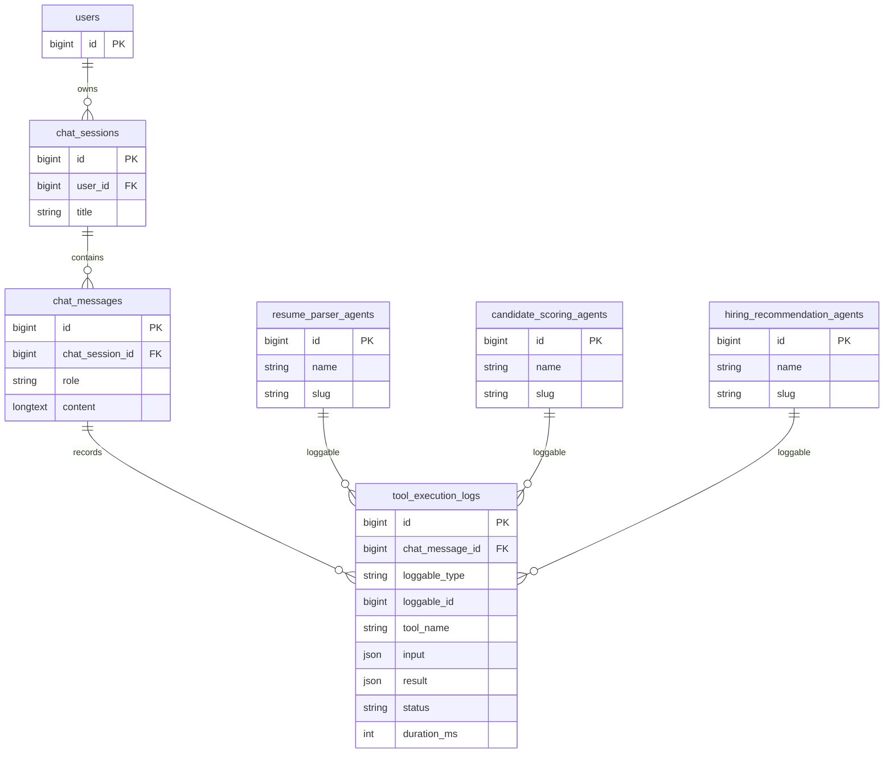
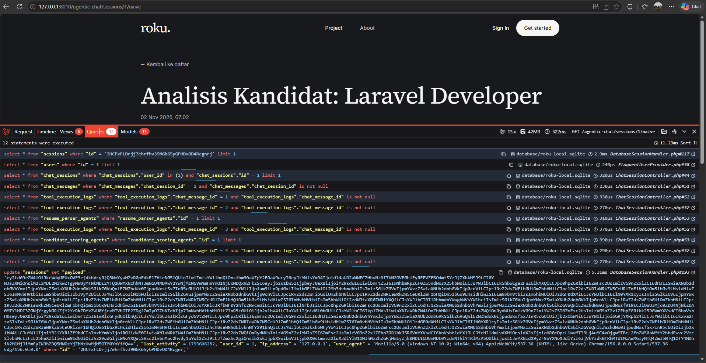
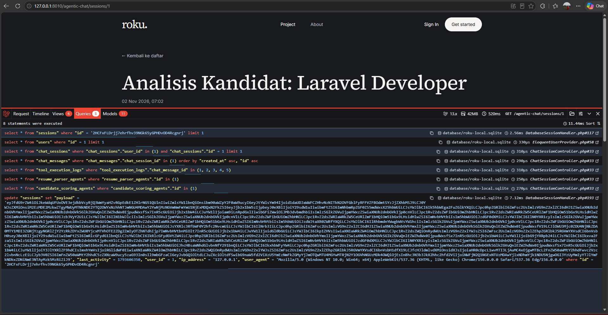

# Roku — AI Hiring Agent

Roku is a group project for recruitment teams. It organizes companies, jobs, candidates, applications, supporting documents, AI screening records, and activity history. AI screening is advisory: people make hiring decisions. Week 9 adds a relational foundation for agent-assisted chat and tool execution logs; the seeded records are a database demonstration and do not call an LLM.

## Stack

- Laravel 13, PHP 8.4+, Filament 5, Livewire 4
- SQLite by default, with the configured Laravel database connection used by the app
- Tailwind CSS 4 and Vite 8
- Pest 5 and Laravel Pint

Check the installed dependency versions with `composer show --direct`. The lockfile is the dependency source of truth. Use PHP 8.4+ for the locked Pest 5 toolchain.

## Existing recruitment platform

The original application remains in place. Its primary records are:

| Area | Tables and models |
| --- | --- |
| Organization | `companies`, `users`, `company_invitations` |
| Hiring | `jobs`, `candidates`, `applications`, `application_documents` |
| Screening and history | `ai_screenings`, `email_messages`, `activity_logs`, `settings` |
| Queue infrastructure | `queue_jobs`, `jobs` (framework queue payloads) |

Recruitment records are isolated by `company_id`. Existing restrictive company, candidate, job, application, and document deletion rules are retained. The queue table is named `queue_jobs` by the recruitment migration and must not be renamed. Gmail ingestion, Google Forms, and production LLM orchestration are outside this database demonstration.

Public pages use `routes/web.php` → `PageController` → the `home` and `about` views. The separate Filament panel lives at `/admin`.

## Week 9: Agentic chat data model

The additive migration `2026_11_02_000001_create_agentic_chat_schema.php` adds chat sessions, messages, three agent registries, and tool logs. It does not edit or replace recruitment migrations.

| Model | Table | Relationships |
| --- | --- | --- |
| `User` | `users` | `hasMany(ChatSession)` |
| `ChatSession` | `chat_sessions` | `belongsTo(User)`, `hasMany(ChatMessage)` |
| `ChatMessage` | `chat_messages` | `belongsTo(ChatSession)`, `hasMany(ToolExecutionLog)` |
| `ToolExecutionLog` | `tool_execution_logs` | `belongsTo(ChatMessage)`, `morphTo(loggable)` |
| `ResumeParserAgent` | `resume_parser_agents` | `morphMany(ToolExecutionLog)` |
| `CandidateScoringAgent` | `candidate_scoring_agents` | `morphMany(ToolExecutionLog)` |
| `HiringRecommendationAgent` | `hiring_recommendation_agents` | `morphMany(ToolExecutionLog)` |

Deleting a user cascades to their sessions, messages, and tool logs through database foreign keys. Deleting an agent with Eloquent removes its polymorphic logs through a model deletion hook. Polymorphic `loggable_type` and `loggable_id` identify an agent but cannot have a conventional foreign-key constraint; `Relation::enforceMorphMap()` stores the stable aliases `resume_parser`, `candidate_scoring`, and `hiring_recommendation`.



The polymorphic agent links above are conceptual; only `chat_message_id`, `chat_session_id`, and `user_id` are database foreign keys. Those foreign keys use cascading deletion. The log table also indexes its message and polymorphic lookup columns.

### Chat history and eager loading

Authenticated routes under `/agentic-chat/sessions` list a user's sessions and show a session detail. The controller scopes both lookups to the signed-in user. The detail action loads the full relationship graph in bounded queries:

```php
ChatSession::query()
    ->whereBelongsTo($request->user())
    ->with([
        'messages' => fn ($query) => $query->orderBy('created_at')->orderBy('id'),
        'messages.toolExecutionLogs.loggable',
    ])
    ->findOrFail($id);
```

In local development, lazy loading is prevented to surface accidental N+1 access. The local-only `/agentic-chat/sessions/{id}/naive` route deliberately visits each relationship without eager loading for comparison in Debugbar. It is unavailable outside the local environment.

### Demo data

`AgenticChatSeeder` adds two recruitment scenarios: resume analysis and candidate scoring, then shortlist comparison and hiring recommendations. It creates records through Eloquent relationships and includes successful and failed tool logs across all three agent types. It skips creating duplicates after the demo sessions exist.

Set `AGENTIC_CHAT_DEMO_USER_EMAIL` in `.env` to the dedicated local account that should own the conversations. In local and testing environments, the seeder creates that account with the standard local factory credentials if it does not exist. Demo seeding is rejected in every other environment.

Run only this seeder to add the demo conversations:

```bash
php artisan db:seed --class=AgenticChatSeeder
```

The default `DatabaseSeeder` also calls it. `ChatSessionFactory`, `ChatMessageFactory`, `ToolExecutionLogFactory`, and the three agent factories support related test/demo data.

## Debugbar evidence

Laravel Debugbar is a development-only dependency. Keep `APP_DEBUG=false` in production. These screenshots were captured from the local app's Laravel Debugbar **Queries** tab using the seeded chat history:

| Chat history route | Total statements | Relationship loading |
| --- | ---: | --- |
| `/agentic-chat/sessions/1/naive` | 12 | Loads tool logs and agent models while iterating messages |
| `/agentic-chat/sessions/1` | 8 | Eager loads messages, tool logs, and agent models in batches |

The normal route uses four fewer statements for this sample history. The debugbar also shows the repeated per-message log queries on the naive route and the batched log query on the eager-loaded route.

**Naive loading (12 statements):**



**Nested eager loading (8 statements):**



## Local setup

Configure `.env` and the database connection before migrating. On an existing checkout, do not run `composer run setup` because it regenerates `APP_KEY`.

```bash
composer install
php artisan migrate --no-interaction
php artisan make:filament-user
php artisan db:seed --class=AgenticChatSeeder
npm ci
npm run build
composer run dev
```

`php artisan migrate` applies pending migrations, including any pending recruitment migrations, to the configured database. Review `php artisan migrate:status` first. Never use `migrate:fresh` against a database containing recruitment data. `composer run dev` starts the project's configured PHP server, queue listener, log tail, and Vite processes.

Create a local Filament account interactively with `php artisan make:filament-user`; do not commit credentials. Set `AGENTIC_CHAT_DEMO_USER_EMAIL` to that account's email before seeding if you want it to own the demo conversations; otherwise the local-only seeder creates the configured default demo account. Authenticated users can open Agentic Chat from the public navigation; each chat query is scoped to the signed-in user.

## Checks

```bash
php artisan test --compact tests/Feature/AgenticChatTest.php
php artisan test --compact
vendor/bin/pint --dirty --format agent
npm run build
```

The tests cover relationship behavior, polymorphic resolution and agent cleanup, database cascades, ownership isolation, factories/seeding, and query growth with a larger history. The existing `tests/Feature/ExampleTest.php` has a known stale assertion that expects the valid `/about` page to be absent; check that expectation before attributing its failure to this module.

## Week 9 rubric mapping

| Rubric | Implementation |
| --- | --- |
| Schema and migrations (35%) | Additive migrations with relational foreign keys and cascades |
| Models and ORM (25%) | Typed `hasMany`, `belongsTo`, `morphMany`, and `morphTo` relations |
| Eager loading (20%) | Nested history loading plus query-growth feature coverage |
| A+ challenge (10%) | Morph map and polymorphic logs for three agent types |
| Code quality (10%) | Existing Laravel conventions, casts, factories, tests, and Pint |

## Slides and group submission

The course submission also requires a group GitHub repository, this ERD in `README.md`, and a pitch of at most five slides/five minutes for the next meeting. Prepare and submit the slides and repository link through the course LMS separately.
