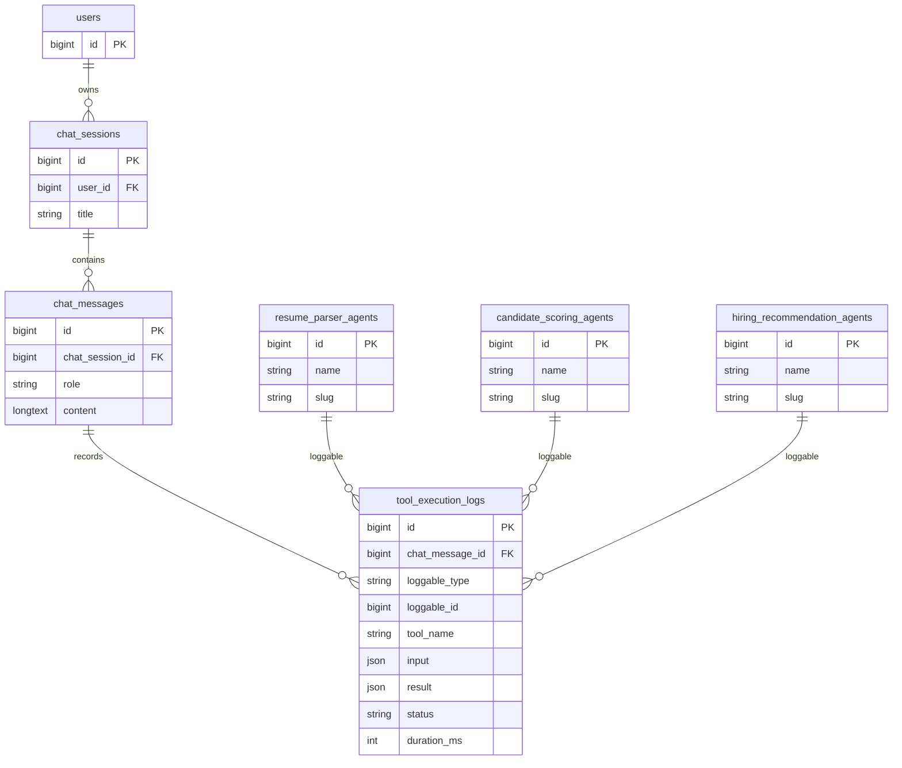

# Roku — AI Hiring Agent

Roku is a group project for recruitment teams. It organizes companies, jobs, candidates, applications, supporting documents, AI screening records, and activity history. AI screening is advisory: people make hiring decisions. Week 9 adds a relational foundation for agent-assisted chat and tool execution logs; the seeded records are a database demonstration and do not call an LLM.

## Stack

- Laravel 13, PHP 8.4+, Filament 5, Livewire 4
- SQLite by default, with the configured Laravel database connection used by the app
- Tailwind CSS 4 and Vite 8
- Pest 5 and Laravel Pint

Check the installed dependency versions with `composer show --direct`. The lockfile is the dependency source of truth. Use PHP 8.4+ for the locked Pest 5 toolchain.

## Existing recruitment platform

The original application remains in place. Its primary records are:

| Area | Tables and models |
| --- | --- |
| Organization | `companies`, `users`, `company_invitations` |
| Hiring | `jobs`, `candidates`, `applications`, `application_documents` |
| Screening and history | `ai_screenings`, `email_messages`, `activity_logs`, `settings` |
| Queue infrastructure | `queue_jobs`, `jobs` (framework queue payloads) |

Recruitment records are isolated by `company_id`. Existing restrictive company, candidate, job, application, and document deletion rules are retained. The queue table is named `queue_jobs` by the recruitment migration and must not be renamed. Gmail ingestion, Google Forms, and production LLM orchestration are outside this database demonstration.

Public pages use `routes/web.php` → `PageController` → the `home` and `about` views. The separate Filament panel lives at `/admin`.

## Week 9: Agentic chat data model

The additive migration `2026_11_02_000001_create_agentic_chat_schema.php` adds chat sessions, messages, three agent registries, and tool logs. It does not edit or replace recruitment migrations.

| Model | Table | Relationships |
| --- | --- | --- |
| `User` | `users` | `hasMany(ChatSession)` |
| `ChatSession` | `chat_sessions` | `belongsTo(User)`, `hasMany(ChatMessage)` |
| `ChatMessage` | `chat_messages` | `belongsTo(ChatSession)`, `hasMany(ToolExecutionLog)` |
| `ToolExecutionLog` | `tool_execution_logs` | `belongsTo(ChatMessage)`, `morphTo(loggable)` |
| `ResumeParserAgent` | `resume_parser_agents` | `morphMany(ToolExecutionLog)` |
| `CandidateScoringAgent` | `candidate_scoring_agents` | `morphMany(ToolExecutionLog)` |
| `HiringRecommendationAgent` | `hiring_recommendation_agents` | `morphMany(ToolExecutionLog)` |

Deleting a user cascades to their sessions, messages, and tool logs through database foreign keys. Deleting an agent with Eloquent removes its polymorphic logs through a model deletion hook. Polymorphic `loggable_type` and `loggable_id` identify an agent but cannot have a conventional foreign-key constraint; `Relation::enforceMorphMap()` stores the stable aliases `resume_parser`, `candidate_scoring`, and `hiring_recommendation`.



The polymorphic agent links above are conceptual; only `chat_message_id`, `chat_session_id`, and `user_id` are database foreign keys. Those foreign keys use cascading deletion. The log table also indexes its message and polymorphic lookup columns.

### Chat history and eager loading

The interactive workspace lives at `/agentic-chat` and lists a user's sessions in its sidebar. The read-only history detail at `/agentic-chat/sessions/{id}` remains available for deep links, and `/agentic-chat/sessions` now redirects to the workspace. The controller scopes both lookups to the signed-in user. The detail action loads the full relationship graph in bounded queries:

```php
ChatSession::query()
    ->whereBelongsTo($request->user())
    ->with([
        'messages' => fn ($query) => $query->orderBy('created_at')->orderBy('id'),
        'messages.toolExecutionLogs.loggable',
    ])
    ->findOrFail($id);
```

In local development, lazy loading is prevented to surface accidental N+1 access. The local-only `/agentic-chat/sessions/{id}/naive` route deliberately visits each relationship without eager loading for comparison in Debugbar. It is unavailable outside the local environment.

### Demo data

`AgenticChatSeeder` adds two recruitment scenarios: resume analysis and candidate scoring, then shortlist comparison and hiring recommendations. It creates records through Eloquent relationships and includes successful and failed tool logs across all three agent types. It skips creating duplicates after the demo sessions exist.

Set `AGENTIC_CHAT_DEMO_USER_EMAIL` in `.env` to the dedicated local account that should own the conversations. In local and testing environments, the seeder creates that account with the standard local factory credentials if it does not exist. Demo seeding is rejected in every other environment.

Run only this seeder to add the demo conversations:

```bash
php artisan db:seed --class=AgenticChatSeeder
```

The default `DatabaseSeeder` also calls it. `ChatSessionFactory`, `ChatMessageFactory`, `ToolExecutionLogFactory`, and the three agent factories support related test/demo data.

## Debugbar evidence

Laravel Debugbar is a development-only dependency. Keep `APP_DEBUG=false` in production. These screenshots were captured from the local app's Laravel Debugbar **Queries** tab using the seeded chat history:

| Chat history route | Total statements | Relationship loading |
| --- | ---: | --- |
| `/agentic-chat/sessions/1/naive` | 12 | Loads tool logs and agent models while iterating messages |
| `/agentic-chat/sessions/1` | 8 | Eager loads messages, tool logs, and agent models in batches |

The normal route uses four fewer statements for this sample history. The debugbar also shows the repeated per-message log queries on the naive route and the batched log query on the eager-loaded route.

**Naive loading (12 statements):**


**Nested eager loading (8 statements):**


## Local setup

Configure `.env` and the database connection before migrating. On an existing checkout, do not run `composer run setup` because it regenerates `APP_KEY`.

```bash
composer install
php artisan migrate --no-interaction
php artisan make:filament-user
php artisan db:seed --class=AgenticChatSeeder
npm ci
npm run build
composer run dev
```

`php artisan migrate` applies pending migrations, including any pending recruitment migrations, to the configured database. Review `php artisan migrate:status` first. Never use `migrate:fresh` against a database containing recruitment data. `composer run dev` starts the project's configured PHP server, queue listener, log tail, and Vite processes.

Create a local Filament account interactively with `php artisan make:filament-user`; do not commit credentials. Set `AGENTIC_CHAT_DEMO_USER_EMAIL` to that account's email before seeding if you want it to own the demo conversations; otherwise the local-only seeder creates the configured default demo account. Authenticated users can open Agentic Chat from the public navigation; each chat query is scoped to the signed-in user.

## Checks

```bash
php artisan test --compact tests/Feature/AgenticChatTest.php
php artisan test --compact
vendor/bin/pint --dirty --format agent
npm run build
```

The tests cover relationship behavior, polymorphic resolution and agent cleanup, database cascades, ownership isolation, factories/seeding, and query growth with a larger history. The existing `tests/Feature/ExampleTest.php` has a known stale assertion that expects the valid `/about` page to be absent; check that expectation before attributing its failure to this module.

## Week 9 rubric mapping

| Rubric | Implementation |
| --- | --- |
| Schema and migrations (35%) | Additive migrations with relational foreign keys and cascades |
| Models and ORM (25%) | Typed `hasMany`, `belongsTo`, `morphMany`, and `morphTo` relations |
| Eager loading (20%) | Nested history loading plus query-growth feature coverage |
| A+ challenge (10%) | Morph map and polymorphic logs for three agent types |
| Code quality (10%) | Existing Laravel conventions, casts, factories, tests, and Pint |

## Slides and group submission

The course submission also requires a group GitHub repository, this ERD in `README.md`, and a pitch of at most five slides/five minutes for the next meeting. Prepare and submit the slides and repository link through the course LMS separately.

---

## Secure LLM Chat API Hub

Fitur **Secure LLM Chat API Hub** adalah modul backend terproteksi yang berfungsi sebagai gerbang komunikasi antara klien dan model kecerdasan buatan (Large Language Model). Modul ini mengintegrasikan model lokal melalui Ollama serta layanan Senopati AI ITS dengan protokol OpenAI-compatible. Seluruh komunikasi API diamankan menggunakan token Laravel Sanctum, divalidasi secara ketat melalui FormRequest, dicatat ke dalam basis data relasional secara atomik, dan dilengkapi fitur tingkat lanjut berupa Server-Sent Events (SSE) streaming, injeksi system prompt di sisi server, serta mekanisme pengalihan kegagalan (fallback) otomatis.

### 1. Panduan Pengaturan dan Instalasi (Setup)

Ikuti langkah-langkah berikut untuk mengonfigurasi dan menjalankan API Hub pada lingkungan lokal:

1. **Konfigurasi Lingkungan (`.env`)**:
   Salin berkas contoh atau perbarui berkas `.env` dengan variabel LLM berikut:
   ```env
   LLM_PROVIDER=ollama
   OLLAMA_BASE_URL=http://localhost:11434
   OLLAMA_MODEL=qwen3:14b
   SENOPATI_BASE_URL=https://senopati.its.ac.id/llm-gateway/v1
   SENOPATI_API_KEY=kunci_api_senopati_anda
   SENOPATI_MODEL=qwen3:14b
   LLM_TIMEOUT=30
   LLM_CONNECT_TIMEOUT=3
   LLM_SYSTEM_PROMPT="Anda adalah asisten rekrutmen (HR) Roku. Bantu menganalisis CV, menilai kandidat, dan menyusun rekomendasi perekrutan secara objektif. Keputusan akhir tetap berada di tangan manusia dan rekomendasi ini bersifat advisory."
   ```

   > **Catatan Windows/PHP:** panggilan HTTPS ke Senopati memerlukan CA bundle. Bila muncul `cURL error 60: self-signed certificate in certificate chain`, set `curl.cainfo` dan `openssl.cafile` di `php.ini` ke CA bundle (mis. `C:\xampp\apache\bin\curl-ca-bundle.crt`), lalu restart server.

2. **Jalankan Migrasi Database**:
   Jalankan migrasi untuk membuat tabel `personal_access_tokens` dan `chat_logs`:
   ```bash
   php artisan migrate --no-interaction
   ```

3. **Inisialisasi Data Demo (Seeder)**:
   Buat akun pengguna demo dan data riwayat obrolan awal:
   ```bash
   php artisan db:seed --class=AgenticChatSeeder
   php artisan db:seed --class=ChatLogSeeder
   ```
   Akun demo default yang tersedia untuk pengujian:
   - **Email:** `test@example.com`
   - **Kata Sandi:** `password`

4. **Menjalankan Layanan Ollama Lokal**:
   Pastikan Ollama telah terpasang dan model yang dikonfigurasi benar-benar sudah diunduh. Tanpa model, `POST /api/chat` membalas HTTP 404 `model '...' not found` dan permintaan dialihkan ke Senopati:
   ```bash
   ollama serve
   ollama pull qwen3:14b
   ollama list
   ```

   Endpoint Senopati memakai gateway OpenAI-compatible ITS: `SENOPATI_BASE_URL=https://senopati.its.ac.id/llm-gateway/v1` (path `/chat/completions` ditambahkan oleh client). Untuk streaming, client mengirim `stream_options.include_usage` sehingga metadata token tetap tercatat di `chat_logs`.

5. **Menjalankan Server Laravel**:
   ```bash
   php artisan serve
   ```

---

### 2. Tabel Kontrak API (API Contract)

Seluruh endpoint API berada di bawah prefiks `/api` dengan format data JSON.

| Metode | Endpoint URL | Autentikasi | Parameter Permintaan | Aturan Validasi |
| :--- | :--- | :--- | :--- | :--- |
| `POST` | `/api/login` | Publik (Throttle 30/menit) | `email` (string), `password` (string), `device_name` (opsional) | `email`: required, email valid.<br>`password`: required, string. |
| `POST` | `/api/register` | Publik (Throttle 30/menit) | `name` (string), `email` (string), `password` (string), `company_name` (opsional) | `name`: required, max 255.<br>`email`: required, email, unique.<br>`password`: required, min 8 karakter.<br>`company_name`: opsional string. |
| `POST` | `/api/logout` | `auth:sanctum` | Tidak ada | Memerlukan Bearer Token yang sah. |
| `POST` | `/api/chat-ai` | `auth:sanctum` (Throttle 20/menit) | `prompt` (string), `session_id` (opsional integer) | `prompt`: required, string, max 1000 karakter.<br>`session_id`: nullable, integer, harus terdaftar di `chat_sessions` milik pengguna yang login. |
| `POST` | `/api/chat-ai/stream` | `auth:sanctum` (Throttle 20/menit) | `prompt` (string), `session_id` (opsional integer) | Sama dengan aturan pada `POST /api/chat-ai`. Header `Accept: text/event-stream`. |
| `GET` | `/api/chat-ai/history` | `auth:sanctum` (Throttle 20/menit) | `session_id` (opsional, query string) | Hanya mengembalikan `chat_logs` milik pengguna yang login, maksimal 50 entri terbaru. `session_id` milik pengguna lain menghasilkan HTTP 422. |

---

### 3. Contoh Permintaan dan Respons JSON

#### A. Permintaan Berhasil (200 OK)
**Endpoint:** `POST /api/chat-ai`  
**Header:** `Authorization: Bearer <token>`, `Accept: application/json`, `Content-Type: application/json`

**Payload Permintaan:**
```json
{
  "prompt": "Jelaskan peran penting seorang Senior Backend Engineer dalam arsitektur microservices!"
}
```

**Respons JSON (Kontrak Standar):**
```json
{
  "status": "success",
  "data": {
    "session_id": 1,
    "model_used": "qwen3:14b",
    "prompt": "Jelaskan peran penting seorang Senior Backend Engineer dalam arsitektur microservices!",
    "ai_response": "Senior Backend Engineer bertanggung jawab merancang batasan domain layanan (service boundaries), mengelola komunikasi asinkron via message broker, serta menjamin keandalan data dan konsistensi lintas layanan.",
    "timestamp": "2026-11-16 10:30:00"
  }
}
```

---

#### B. Kesalahan Autentikasi (401 Unauthorized)
Terjadi saat permintaan tidak menyertakan Authorization token atau token tidak sah.

**Respons JSON:**
```json
{
  "status": "error",
  "message": "Unauthenticated. Token otentikasi tidak ditemukan atau tidak valid."
}
```

---

#### C. Kesalahan Validasi Input (422 Unprocessable Content)
Terjadi saat prompt kosong, melebihi 1000 karakter, atau `session_id` milik pengguna lain.

**Respons JSON:**
```json
{
  "status": "error",
  "message": "Validasi gagal.",
  "errors": {
    "prompt": [
      "Prompt tidak boleh lebih dari 1000 karakter."
    ],
    "session_id": [
      "Sesi obrolan tidak ditemukan atau bukan milik pengguna yang sedang login."
    ]
  }
}
```

---

#### D. Kesalahan Layanan LLM / Kegagalan Koneksi (503 Service Unavailable)
Terjadi saat kedua penyedia LLM (Ollama dan Senopati) tidak dapat dihubungi atau mengalami batas waktu koneksi.

**Respons JSON:**
```json
{
  "status": "error",
  "message": "Layanan LLM utama (Ollama) dan fallback (Senopati) tidak dapat dihubungi."
}
```

Pesan galat lain yang mungkin muncul:

| Status | `message` | Penyebab |
| :---: | :--- | :--- |
| `502` | `Ollama menolak permintaan yang dikirim.` | Ollama membalas 4xx selain 404 (permintaan tidak valid); **tidak** diulang ke Senopati. |
| `502` | `Model Ollama yang dikonfigurasi tidak tersedia pada server lokal.` | Ollama membalas 404 (model belum di-pull); otomatis dialihkan ke Senopati. |
| `502` | `Endpoint Senopati AI ITS tidak ditemukan. Periksa SENOPATI_BASE_URL.` | Path gateway salah; hanya muncul bila Senopati dipakai sebagai provider utama. |
| `502` | `Respons dari Ollama tidak dapat dibaca.` | Body respons bukan JSON yang valid. |
| `502` | `Respons Ollama tidak memuat konten jawaban.` | JSON valid tetapi tidak berisi `message.content`. |
| `500` | `Terjadi kesalahan sistem saat menghubungi layanan LLM.` | Kesalahan tak terduga (tidak memicu fallback dan tidak membocorkan detail internal). |

Seluruh pesan di atas sudah dikurasi: API key, URL internal, stack trace, dan pesan exception mentah hanya dicatat pada log server (`storage/logs`).

---

### 4. Cara Uji Streaming SSE (`curl -N`)

Pengujian endpoint streaming dapat dilakukan melalui terminal menggunakan perintah `curl` dengan flag `-N` (no buffer) agar event stream tampil secara real-time:

```bash
# 1. Dapatkan token autentikasi melalui login
TOKEN=$(curl -s -X POST http://localhost:8000/api/login \
  -H "Content-Type: application/json" \
  -H "Accept: application/json" \
  -d '{"email":"test@example.com","password":"password"}' | grep -o '"token":"[^"]*' | cut -d'"' -f4)

# 2. Eksekusi permintaan streaming SSE
curl -N -X POST http://localhost:8000/api/chat-ai/stream \
  -H "Authorization: Bearer $TOKEN" \
  -H "Accept: text/event-stream" \
  -H "Content-Type: application/json" \
  -d '{"prompt":"Berikan 3 pertanyaan wawancara teknis untuk posisi Lead Engineer!"}'
```

**Bentuk Keluaran Streaming:**
```text
data: {"chunk":"Berikut "}

data: {"chunk":"adalah "}

data: {"chunk":"tiga pertanyaan wawancara: ..."}

data: {"session_id":2,"model_used":"qwen3:14b","provider":"ollama","tokens":{"prompt":24,"completion":68,"total":92},"status":"[DONE]"}

data: [DONE]
```

**Kontrak SSE:**

1. Setiap potongan jawaban dikirim sebagai event `data: {"chunk": "..."}` tanpa nama event.
2. Event metadata terakhir berisi `session_id`, `model_used`, `provider`, `tokens`, dan `status: "[DONE]"`.
3. Baris penutup `data: [DONE]` menandakan stream berakhir dan dapat digunakan klien sebagai sinyal terminasi.
4. Jika penyedia gagal sebelum potongan pertama, sistem otomatis melakukan fallback ke Senopati AI ITS dan stream tetap berjalan normal.
5. Jika penyedia gagal **setelah** potongan pertama terkirim, fallback dibatalkan agar jawaban dua penyedia tidak tercampur. Klien menerima event `error` berikut lalu stream ditutup **tanpa** `[DONE]`:

```text
event: error
data: {"status":"error","message":"Respons streaming dari penyedia LLM terputus sebelum selesai. Silakan ulangi permintaan."}
```

6. Kegagalan yang terjadi sebelum ada output sama sekali mengirim pesan `Layanan streaming LLM tidak dapat dihubungi. Silakan coba lagi.`
7. Pesan pada event `error` selalu bersifat generik; detail exception hanya masuk ke log server.
8. `chat_messages` (user + assistant) dan `chat_logs` hanya ditulis bila stream selesai dengan sukses, di dalam satu transaksi database.

---

### 5. Penjelasan Injeksi System Prompt dan Fallback Otomatis
1. **Injeksi System Prompt Sisi Server (Challenge 2)**:
   - Setiap panggilan ke LLM selalu menyisipkan system prompt rekrutmen dari `config('llm.system_prompt')` pada elemen pertama array pesan (`role: system`).
   - Pengguna hanya memiliki kontrol terhadap isi `prompt` (`role: user`), sehingga tidak dapat membajak atau menimpa kepribadian dan pedoman etika asisten rekrutmen.
   - Jawaban yang dihasilkan selalu mengedepankan prinsip bahwa hasil evaluasi AI bersifat *advisory*, sedangkan keputusan penerimaan mutlak berada di tangan rekruter manusia.

2. **Mekanisme Fallback Otomatis (Challenge 3)**:
   - `LlmManager` mengeksekusi panggilan utama ke penyedia lokal (Ollama) dengan waktu tunggu koneksi singkat (3 detik).
   - Fallback ke Senopati AI ITS **hanya** dilakukan untuk kegagalan yang bersifat sementara: connection refused, connection timeout, HTTP 5xx, HTTP 404 (model/endpoint tidak ada di sisi penyedia), respons rusak, atau respons tanpa konten. Kegagalan tersebut ditandai `retryable` pada `LlmException`.
   - HTTP 4xx lain dari penyedia (permintaan tidak valid) **tidak** diulang ke penyedia lain, dan kesalahan pemrograman tak terduga (mis. `TypeError`) juga tidak disamarkan dengan fallback. Keduanya dikembalikan sebagai galat terstruktur.
   - Setiap fallback dicatat melalui `Log::warning(...)`; kegagalan kedua penyedia dicatat melalui `Log::error(...)` beserta exception aslinya. Detail ini tidak pernah dikirim ke klien.
   - Untuk streaming, fallback hanya diizinkan **sebelum** potongan pertama dikirim ke klien. `LlmManager` menghitung chunk yang sudah dikirim dan menolak pergantian penyedia setelahnya sehingga tidak ada respons campuran.
   - Kolom `provider` dan `model_used` pada tabel `chat_logs` mencatat penyedia aktual yang berhasil melayani permintaan tersebut.

3. **Penulisan Database Atomik**:
   - Satu interaksi sukses menulis `chat_messages` (user dan assistant) serta `chat_logs` di dalam `DB::transaction(...)`. Jika salah satu gagal, seluruh penulisan dibatalkan sehingga tidak ada percakapan setengah jadi atau duplikat.
   - Jika penyedia tidak mengirim metadata usage, kolom `prompt_tokens`, `completion_tokens`, dan `total_tokens` disimpan sebagai `NULL`. Bila metadata tersedia (Ollama `prompt_eval_count`/`eval_count`, Senopati `usage`), nilainya disimpan apa adanya.
   - Panggilan LLM yang gagal tidak membuat baris apa pun pada `chat_sessions`, `chat_messages`, maupun `chat_logs`.
   - `GET /api/chat-ai/history` selalu dibatasi `whereBelongsTo($user)` sehingga pengguna tidak dapat membaca riwayat pengguna lain.

---

### 6. Pengujian Otomatis

Seluruh perilaku di atas diuji tanpa ketergantungan pada Ollama/Senopati sungguhan (menggunakan `Http::fake()` dan test double `LlmClientInterface`):

```bash
php artisan test --compact tests/Feature/ChatAiApiTest.php
php artisan test --compact tests/Feature/ChatAiApiHardeningTest.php
php artisan test --compact tests/Feature/AgenticChatWorkspaceTest.php
php artisan test --compact tests/Feature/LlmServiceTest.php
php artisan test --compact tests/Feature/ChatLogModelTest.php
```

`AgenticChatWorkspaceTest` mencakup akses halaman, isolasi kepemilikan sesi, pemilihan sesi dan obrolan baru, endpoint streaming browser (sukses, gagal, sesi milik pengguna lain, tamu), serta tidak adanya duplikasi baris database.

`ChatAiApiHardeningTest` mencakup token tidak valid/dicabut, validasi prompt (kosong, bukan string, 1000 karakter), kegagalan penyedia tanpa baris database, 4xx tanpa fallback, timeout/connection refused dengan fallback, metadata token `NULL`, error SSE yang tidak membocorkan detail internal, larangan pencampuran penyedia setelah output pertama, serta isolasi riwayat obrolan antarpengguna.

### 7. Antarmuka Web: Agentic Chat Workspace

Selain API, modul ini memiliki antarmuka obrolan di dalam aplikasi Roku:

| Aspek | Implementasi |
| :--- | :--- |
| Halaman | `GET /agentic-chat` (middleware `auth`), komponen Livewire `App\Livewire\AgenticChatWorkspace` |
| Navigasi | Tautan **Agentic Chat** pada `layouts.app` mengarah ke workspace; `/agentic-chat/sessions` dialihkan (302) ke workspace |
| Sidebar | Daftar maksimal 50 sesi milik pengguna, waktu aktivitas terakhir, jumlah pesan, tombol **Obrolan baru**, dan penanda `aria-current` untuk sesi aktif |
| Area obrolan | Bubble pengguna/asisten, multiline textarea, Enter = kirim, Shift+Enter = baris baru, auto-scroll, indikator mengetik, dan status `aria-live` |
| Metadata | Model, provider aktual (ollama/senopati), serta prompt/completion/total token dibaca dari `chat_logs` terakhir dan diperbarui langsung dari event metadata SSE |
| Transport | `POST /agentic-chat/stream` di grup middleware `web` (sesi login + CSRF), memakai ulang `ChatAiController@stream` |
| Error state | Pesan generik dari server ditampilkan di panel error dengan tombol **Ulangi** |

**Arsitektur integrasi.** Tidak ada logika LLM yang diduplikasi. `App\Services\Chat\ChatConversationService` menjadi satu-satunya sumber untuk injeksi system prompt, penyusunan konteks, pembuatan sesi, dan penulisan transaksi (`chat_messages` + `chat_logs`). API controller (`POST /api/chat-ai`, `POST /api/chat-ai/stream`) dan transport browser memakai service yang sama.

**Streaming di browser.** `resources/js/agentic-chat.js` meng-`fetch` endpoint SSE dengan `Accept: text/event-stream` dan header `X-CSRF-TOKEN`, lalu membaca body lewat `ReadableStream` sehingga setiap chunk langsung dirender. Kontrak yang dipatuhi sama dengan API: event `{"chunk": "..."}`, event metadata berstatus `[DONE]`, baris penutup `data: [DONE]`, dan `event: error` untuk kegagalan. Bila penyedia gagal setelah output pertama, server mengirim error dan jawaban tidak pernah dicampur antar penyedia. Setelah `[DONE]`, browser memanggil aksi Livewire `conversationCompleted(sessionId)` sehingga pesan yang tampil diambil ulang dari database — tidak ada baris ganda dan tidak ada duplikasi bubble.

**Keamanan.** Browser tidak pernah menyimpan token Sanctum: autentikasi memakai sesi Laravel + CSRF. Setiap aksi Livewire dan setiap permintaan stream memvalidasi kepemilikan sesi melalui `whereBelongsTo($user)`; `session_id` milik pengguna lain menghasilkan 404 (halaman) atau 422 (stream). API key Senopati tetap hanya di server (`config/llm.php`).

### 8. Pemetaan Terhadap Rubrik Penilaian

| Komponen Penilaian | Bobot | Implementasi Teknis pada Repositori |
| :--- | :---: | :--- |
| **Fungsionalitas dan Koneksi LLM** | 40% | Service layer modular (`LlmClientInterface`, `OllamaClient`, `SenopatiClient`, `LlmManager`), konfigurasi dinamis `config/llm.php`, binding pada ServiceProvider, dan error handling terstruktur tanpa kebocoran kunci API. |
| **Autentikasi dan Validasi Sanctum** | 20% | Instalasi Laravel Sanctum, trait `HasApiTokens` pada model `User`, penanganan exception 401 JSON global, FormRequest `ChatAiRequest` berbahasa Indonesia, pembatasan kepemilikan sesi, dan rate limiting throttle. |
| **Logging dan Riwayat Database** | 20% | Migrasi additive `chat_logs`, model `ChatLog`, factory, seeder, relasi Eloquent, scoping data pengguna (`GET /api/chat-ai/history`), eager loading anti N+1, penulisan `chat_messages` dan `chat_logs` dalam satu DB transaction, serta penyimpanan token usage `NULL`-safe. |
| **Standardisasi JSON via API Resource** | 10% | Transformasi melalui `ChatLogResource` dengan format timestamp `Y-m-d H:i:s` dan envelope konsisten berstatus `success` atau `error`. |
| **Fitur Unggulan Challenge A+** | 10% | Implementasi lengkap ketiga challenge: (1) SSE Streaming `POST /api/chat-ai/stream` dengan event `[DONE]` dan larangan pencampuran penyedia setelah output pertama, (2) Server-side System Prompt Injection HR Roku, dan (3) Automatic Fallback dari Ollama ke Senopati AI ITS yang hanya aktif untuk kegagalan sementara. |
| **Kerapian Kode dan Standar PSR-12** | 10% | Pemenuhan standar PSR-12 melalui Laravel Pint, penataan direktori modular (Controllers/Api, Requests, Resources, Services/Llm), type hints, return types, dan ketiadaan kode sampah / debug statemen. |

