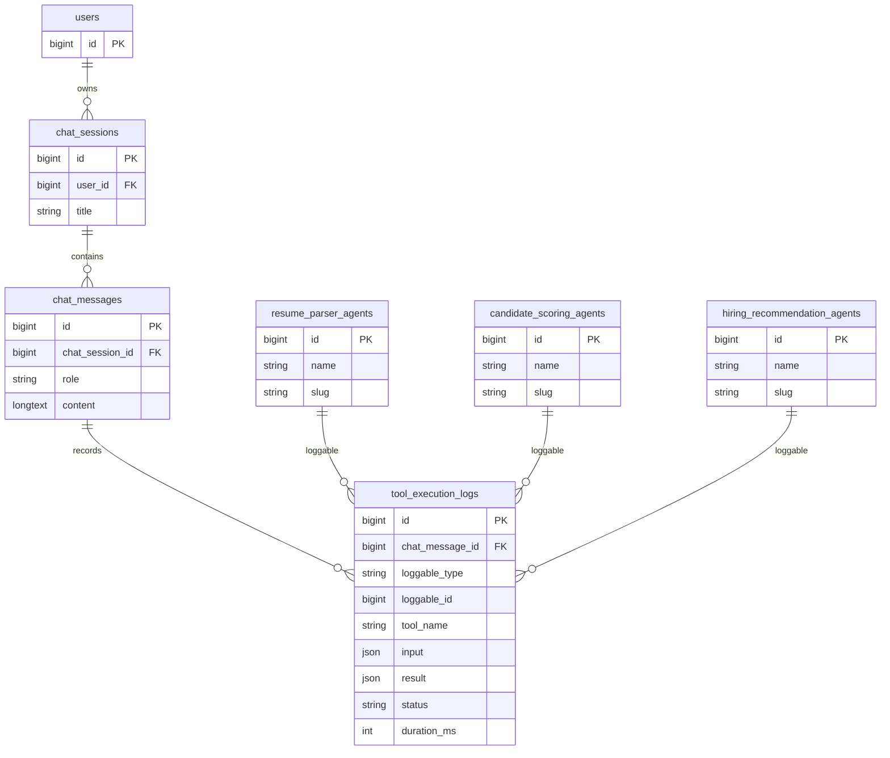
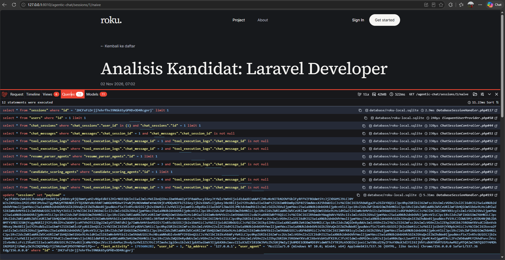
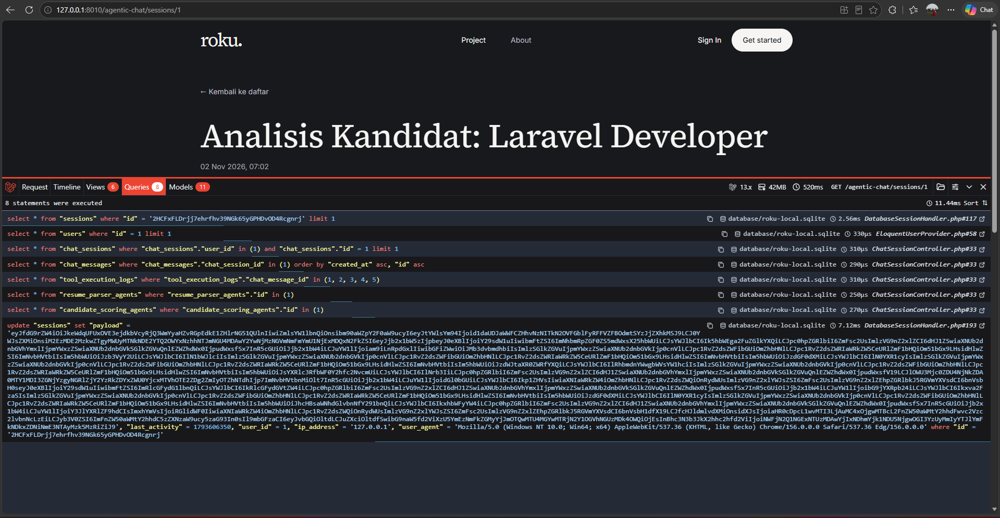

# Roku — AI Hiring Agent

Roku is a group project for recruitment teams. It organizes companies, jobs, candidates, applications, supporting documents, AI screening records, and activity history. AI screening is advisory: people make hiring decisions. Week 9 adds a relational foundation for agent-assisted chat and tool execution logs; the seeded records are a database demonstration and do not call an LLM.

## Stack

- Laravel 13, PHP 8.4+, Filament 5, Livewire 4
- SQLite by default, with the configured Laravel database connection used by the app
- Tailwind CSS 4 and Vite 8
- Pest 5 and Laravel Pint

Check the installed dependency versions with `composer show --direct`. The lockfile is the dependency source of truth. Use PHP 8.4+ for the locked Pest 5 toolchain.

## Existing recruitment platform

The original application remains in place. Its primary records are:

| Area | Tables and models |
| --- | --- |
| Organization | `companies`, `users`, `company_invitations` |
| Hiring | `jobs`, `candidates`, `applications`, `application_documents` |
| Screening and history | `ai_screenings`, `email_messages`, `activity_logs`, `settings` |
| Queue infrastructure | `queue_jobs`, `jobs` (framework queue payloads) |

Recruitment records are isolated by `company_id`. Existing restrictive company, candidate, job, application, and document deletion rules are retained. The queue table is named `queue_jobs` by the recruitment migration and must not be renamed. Gmail ingestion, Google Forms, and production LLM orchestration are outside this database demonstration.

Public pages use `routes/web.php` → `PageController` → the `home` and `about` views. The separate Filament panel lives at `/admin`.

## Week 9: Agentic chat data model

The additive migration `2026_11_02_000001_create_agentic_chat_schema.php` adds chat sessions, messages, three agent registries, and tool logs. It does not edit or replace recruitment migrations.

| Model | Table | Relationships |
| --- | --- | --- |
| `User` | `users` | `hasMany(ChatSession)` |
| `ChatSession` | `chat_sessions` | `belongsTo(User)`, `hasMany(ChatMessage)` |
| `ChatMessage` | `chat_messages` | `belongsTo(ChatSession)`, `hasMany(ToolExecutionLog)` |
| `ToolExecutionLog` | `tool_execution_logs` | `belongsTo(ChatMessage)`, `morphTo(loggable)` |
| `ResumeParserAgent` | `resume_parser_agents` | `morphMany(ToolExecutionLog)` |
| `CandidateScoringAgent` | `candidate_scoring_agents` | `morphMany(ToolExecutionLog)` |
| `HiringRecommendationAgent` | `hiring_recommendation_agents` | `morphMany(ToolExecutionLog)` |

Deleting a user cascades to their sessions, messages, and tool logs through database foreign keys. Deleting an agent with Eloquent removes its polymorphic logs through a model deletion hook. Polymorphic `loggable_type` and `loggable_id` identify an agent but cannot have a conventional foreign-key constraint; `Relation::enforceMorphMap()` stores the stable aliases `resume_parser`, `candidate_scoring`, and `hiring_recommendation`.



The polymorphic agent links above are conceptual; only `chat_message_id`, `chat_session_id`, and `user_id` are database foreign keys. Those foreign keys use cascading deletion. The log table also indexes its message and polymorphic lookup columns.

### Chat history and eager loading

Authenticated routes under `/agentic-chat/sessions` list a user's sessions and show a session detail. The controller scopes both lookups to the signed-in user. The detail action loads the full relationship graph in bounded queries:

```php
ChatSession::query()
    ->whereBelongsTo($request->user())
    ->with([
        'messages' => fn ($query) => $query->orderBy('created_at')->orderBy('id'),
        'messages.toolExecutionLogs.loggable',
    ])
    ->findOrFail($id);
```

In local development, lazy loading is prevented to surface accidental N+1 access. The local-only `/agentic-chat/sessions/{id}/naive` route deliberately visits each relationship without eager loading for comparison in Debugbar. It is unavailable outside the local environment.

### Demo data

`AgenticChatSeeder` adds two recruitment scenarios: resume analysis and candidate scoring, then shortlist comparison and hiring recommendations. It creates records through Eloquent relationships and includes successful and failed tool logs across all three agent types. It skips creating duplicates after the demo sessions exist.

Set `AGENTIC_CHAT_DEMO_USER_EMAIL` in `.env` to the dedicated local account that should own the conversations. In local and testing environments, the seeder creates that account with the standard local factory credentials if it does not exist. Demo seeding is rejected in every other environment.

Run only this seeder to add the demo conversations:

```bash
php artisan db:seed --class=AgenticChatSeeder
```

The default `DatabaseSeeder` also calls it. `ChatSessionFactory`, `ChatMessageFactory`, `ToolExecutionLogFactory`, and the three agent factories support related test/demo data.

## Debugbar evidence

Laravel Debugbar is a development-only dependency. Keep `APP_DEBUG=false` in production. These screenshots were captured from the local app's Laravel Debugbar **Queries** tab using the seeded chat history:

| Chat history route | Total statements | Relationship loading |
| --- | ---: | --- |
| `/agentic-chat/sessions/1/naive` | 12 | Loads tool logs and agent models while iterating messages |
| `/agentic-chat/sessions/1` | 8 | Eager loads messages, tool logs, and agent models in batches |

The normal route uses four fewer statements for this sample history. The debugbar also shows the repeated per-message log queries on the naive route and the batched log query on the eager-loaded route.

**Naive loading (12 statements):**



**Nested eager loading (8 statements):**



## Local setup

Configure `.env` and the database connection before migrating. On an existing checkout, do not run `composer run setup` because it regenerates `APP_KEY`.

```bash
composer install
php artisan migrate --no-interaction
php artisan make:filament-user
php artisan db:seed --class=AgenticChatSeeder
npm ci
npm run build
composer run dev
```

`php artisan migrate` applies pending migrations, including any pending recruitment migrations, to the configured database. Review `php artisan migrate:status` first. Never use `migrate:fresh` against a database containing recruitment data. `composer run dev` starts the project's configured PHP server, queue listener, log tail, and Vite processes.

Create a local Filament account interactively with `php artisan make:filament-user`; do not commit credentials. Set `AGENTIC_CHAT_DEMO_USER_EMAIL` to that account's email before seeding if you want it to own the demo conversations; otherwise the local-only seeder creates the configured default demo account. Authenticated users can open Agentic Chat from the public navigation; each chat query is scoped to the signed-in user.

## Checks

```bash
php artisan test --compact tests/Feature/AgenticChatTest.php
php artisan test --compact
vendor/bin/pint --dirty --format agent
npm run build
```

The tests cover relationship behavior, polymorphic resolution and agent cleanup, database cascades, ownership isolation, factories/seeding, and query growth with a larger history. The existing `tests/Feature/ExampleTest.php` has a known stale assertion that expects the valid `/about` page to be absent; check that expectation before attributing its failure to this module.

## Week 9 rubric mapping

| Rubric | Implementation |
| --- | --- |
| Schema and migrations (35%) | Additive migrations with relational foreign keys and cascades |
| Models and ORM (25%) | Typed `hasMany`, `belongsTo`, `morphMany`, and `morphTo` relations |
| Eager loading (20%) | Nested history loading plus query-growth feature coverage |
| A+ challenge (10%) | Morph map and polymorphic logs for three agent types |
| Code quality (10%) | Existing Laravel conventions, casts, factories, tests, and Pint |

## Slides and group submission

The course submission also requires a group GitHub repository, this ERD in `README.md`, and a pitch of at most five slides/five minutes for the next meeting. Prepare and submit the slides and repository link through the course LMS separately.

---

## Secure LLM Chat API Hub

Fitur **Secure LLM Chat API Hub** adalah modul backend terproteksi yang berfungsi sebagai gerbang komunikasi antara klien dan model kecerdasan buatan (Large Language Model). Modul ini mengintegrasikan model lokal melalui Ollama serta layanan Senopati AI ITS dengan protokol OpenAI-compatible. Seluruh komunikasi API diamankan menggunakan token Laravel Sanctum, divalidasi secara ketat melalui FormRequest, dicatat ke dalam basis data relasional secara atomik, dan dilengkapi fitur tingkat lanjut berupa Server-Sent Events (SSE) streaming, injeksi system prompt di sisi server, serta mekanisme pengalihan kegagalan (fallback) otomatis.

### 1. Panduan Pengaturan dan Instalasi (Setup)

Ikuti langkah-langkah berikut untuk mengonfigurasi dan menjalankan API Hub pada lingkungan lokal:

1. **Konfigurasi Lingkungan (`.env`)**:
   Salin berkas contoh atau perbarui berkas `.env` dengan variabel LLM berikut:
   ```env
   LLM_PROVIDER=ollama
   OLLAMA_BASE_URL=http://localhost:11434
   OLLAMA_MODEL=qwen3:14b
   SENOPATI_BASE_URL=https://senopati.its.ac.id/v1
   SENOPATI_API_KEY=kunci_api_senopati_anda
   SENOPATI_MODEL=qwen3:14b
   LLM_TIMEOUT=30
   LLM_CONNECT_TIMEOUT=3
   LLM_SYSTEM_PROMPT="Anda adalah asisten rekrutmen (HR) Roku. Bantu menganalisis CV, menilai kandidat, dan menyusun rekomendasi perekrutan secara objektif. Keputusan akhir tetap berada di tangan manusia dan rekomendasi ini bersifat advisory."
   ```

2. **Jalankan Migrasi Database**:
   Jalankan migrasi untuk membuat tabel `personal_access_tokens` dan `chat_logs`:
   ```bash
   php artisan migrate --no-interaction
   ```

3. **Inisialisasi Data Demo (Seeder)**:
   Buat akun pengguna demo dan data riwayat obrolan awal:
   ```bash
   php artisan db:seed --class=AgenticChatSeeder
   php artisan db:seed --class=ChatLogSeeder
   ```
   Akun demo default yang tersedia untuk pengujian:
   - **Email:** `test@example.com`
   - **Kata Sandi:** `password`

4. **Menjalankan Layanan Ollama Lokal**:
   Pastikan Ollama telah terpasang dan model yang dikonfigurasi telah diunduh:
   ```bash
   ollama serve
   ollama pull qwen3:14b
   ```

5. **Menjalankan Server Laravel**:
   ```bash
   php artisan serve
   ```

---

### 2. Tabel Kontrak API (API Contract)

Seluruh endpoint API berada di bawah prefiks `/api` dengan format data JSON.

| Metode | Endpoint URL | Autentikasi | Parameter Permintaan | Aturan Validasi |
| :--- | :--- | :--- | :--- | :--- |
| `POST` | `/api/login` | Publik (Throttle 30/menit) | `email` (string), `password` (string), `device_name` (opsional) | `email`: required, email valid.<br>`password`: required, string. |
| `POST` | `/api/register` | Publik (Throttle 30/menit) | `name` (string), `email` (string), `password` (string), `company_name` (opsional) | `name`: required, max 255.<br>`email`: required, email, unique.<br>`password`: required, min 8 karakter.<br>`company_name`: opsional string. |
| `POST` | `/api/logout` | `auth:sanctum` | Tidak ada | Memerlukan Bearer Token yang sah. |
| `POST` | `/api/chat-ai` | `auth:sanctum` (Throttle 20/menit) | `prompt` (string), `session_id` (opsional integer) | `prompt`: required, string, max 1000 karakter.<br>`session_id`: nullable, integer, harus terdaftar di `chat_sessions` milik pengguna yang login. |
| `POST` | `/api/chat-ai/stream` | `auth:sanctum` (Throttle 20/menit) | `prompt` (string), `session_id` (opsional integer) | Sama dengan aturan pada `POST /api/chat-ai`. Header `Accept: text/event-stream`. |

---

### 3. Contoh Permintaan dan Respons JSON

#### A. Permintaan Berhasil (200 OK)
**Endpoint:** `POST /api/chat-ai`  
**Header:** `Authorization: Bearer <token>`, `Accept: application/json`, `Content-Type: application/json`

**Payload Permintaan:**
```json
{
  "prompt": "Jelaskan peran penting seorang Senior Backend Engineer dalam arsitektur microservices!"
}
```

**Respons JSON (Kontrak Standar):**
```json
{
  "status": "success",
  "data": {
    "session_id": 1,
    "model_used": "qwen3:14b",
    "prompt": "Jelaskan peran penting seorang Senior Backend Engineer dalam arsitektur microservices!",
    "ai_response": "Senior Backend Engineer bertanggung jawab merancang batasan domain layanan (service boundaries), mengelola komunikasi asinkron via message broker, serta menjamin keandalan data dan konsistensi lintas layanan.",
    "timestamp": "2026-11-16 10:30:00"
  }
}
```

---

#### B. Kesalahan Autentikasi (401 Unauthorized)
Terjadi saat permintaan tidak menyertakan Authorization token atau token tidak sah.

**Respons JSON:**
```json
{
  "status": "error",
  "message": "Unauthenticated. Token otentikasi tidak ditemukan atau tidak valid."
}
```

---

#### C. Kesalahan Validasi Input (422 Unprocessable Content)
Terjadi saat prompt kosong, melebihi 1000 karakter, atau `session_id` milik pengguna lain.

**Respons JSON:**
```json
{
  "status": "error",
  "message": "Validasi gagal.",
  "errors": {
    "prompt": [
      "Prompt tidak boleh lebih dari 1000 karakter."
    ],
    "session_id": [
      "Sesi obrolan tidak ditemukan atau bukan milik pengguna yang sedang login."
    ]
  }
}
```

---

#### D. Kesalahan Layanan LLM / Kegagalan Koneksi (503 Service Unavailable)
Terjadi saat kedua penyedia LLM (Ollama dan Senopati) tidak dapat dihubungi atau mengalami batas waktu koneksi.

**Respons JSON:**
```json
{
  "status": "error",
  "message": "Layanan LLM utama (Ollama) dan fallback (Senopati) tidak dapat dihubungi."
}
```

---

### 4. Cara Uji Streaming SSE (`curl -N`)

Pengujian endpoint streaming dapat dilakukan melalui terminal menggunakan perintah `curl` dengan flag `-N` (no buffer) agar event stream tampil secara real-time:

```bash
# 1. Dapatkan token autentikasi melalui login
TOKEN=$(curl -s -X POST http://localhost:8000/api/login \
  -H "Content-Type: application/json" \
  -H "Accept: application/json" \
  -d '{"email":"test@example.com","password":"password"}' | grep -o '"token":"[^"]*' | cut -d'"' -f4)

# 2. Eksekusi permintaan streaming SSE
curl -N -X POST http://localhost:8000/api/chat-ai/stream \
  -H "Authorization: Bearer $TOKEN" \
  -H "Accept: text/event-stream" \
  -H "Content-Type: application/json" \
  -d '{"prompt":"Berikan 3 pertanyaan wawancara teknis untuk posisi Lead Engineer!"}'
```

**Bentuk Keluaran Streaming:**
```text
data: {"chunk":"Berikut "}

data: {"chunk":"adalah "}

data: {"chunk":"tiga pertanyaan wawancara: ..."}

data: {"session_id":2,"model_used":"qwen3:14b","provider":"ollama","tokens":{"prompt":24,"completion":68,"total":92},"status":"[DONE]"}
```

Setelah stream selesai, sistem secara otomatis menyimpan akumulasi jawaban ke dalam tabel `chat_logs` dan `chat_messages` dalam satu transaksi database.

---

### 5. Penjelasan Injeksi System Prompt dan Fallback Otomatis

1. **Injeksi System Prompt Sisi Server (Challenge 2)**:
   - Setiap panggilan ke LLM selalu menyisipkan system prompt rekrutmen dari `config('llm.system_prompt')` pada elemen pertama array pesan (`role: system`).
   - Pengguna hanya memiliki kontrol terhadap isi `prompt` (`role: user`), sehingga tidak dapat membajak atau menimpa kepribadian dan pedoman etika asisten rekrutmen.
   - Jawaban yang dihasilkan selalu mengedepankan prinsip bahwa hasil evaluasi AI bersifat *advisory*, sedangkan keputusan penerimaan mutlak berada di tangan rekruter manusia.

2. **Mekanisme Fallback Otomatis (Challenge 3)**:
   - `LlmManager` mengeksekusi panggilan utama ke penyedia lokal (Ollama) dengan waktu tunggu koneksi singkat (3 detik).
   - Jika Ollama mengalami mati daya, penolakan koneksi (connection refused), atau kode HTTP 5xx, `LlmManager` menangkap eksepsi tersebut dan mencatat peringatan melalui `Log::warning(...)`.
   - Permintaan kemudian secara otomatis dialihkan ke penyedia cadangan (Senopati AI ITS) tanpa menimbulkan interupsi pada klien.
   - Kolom `provider` dan `model_used` pada tabel `chat_logs` mencatat penyedia aktual yang berhasil melayani permintaan tersebut.

---

### 6. Pemetaan Terhadap Rubrik Penilaian

| Komponen Penilaian | Bobot | Implementasi Teknis pada Repositori |
| :--- | :---: | :--- |
| **Fungsionalitas dan Koneksi LLM** | 40% | Service layer modular (`LlmClientInterface`, `OllamaClient`, `SenopatiClient`, `LlmManager`), konfigurasi dinamis `config/llm.php`, binding pada ServiceProvider, dan error handling terstruktur tanpa kebocoran kunci API. |
| **Autentikasi dan Validasi Sanctum** | 20% | Instalasi Laravel Sanctum, trait `HasApiTokens` pada model `User`, penanganan exception 401 JSON global, FormRequest `ChatAiRequest` berbahasa Indonesia, pembatasan kepemilikan sesi, dan rate limiting throttle. |
| **Logging dan Riwayat Database** | 20% | Migrasi additive `chat_logs`, model `ChatLog`, factory, seeder, relasi Eloquent, scoping data pengguna, eager loading anti N+1, serta penulisan `chat_messages` dan `chat_logs` dalam satu DB transaction. |
| **Standardisasi JSON via API Resource** | 10% | Transformasi melalui `ChatLogResource` dengan format timestamp `Y-m-d H:i:s` dan envelope konsisten berstatus `success` atau `error`. |
| **Fitur Unggulan Challenge A+** | 10% | Implementasi lengkap ketiga challenge: (1) SSE Streaming `POST /api/chat-ai/stream` dengan penutup `[DONE]`, (2) Server-side System Prompt Injection HR Roku, dan (3) Automatic Fallback dari Ollama ke Senopati AI ITS. |
| **Kerapian Kode dan Standar PSR-12** | 10% | Pemenuhan standar PSR-12 melalui Laravel Pint, penataan direktori modular (Controllers/Api, Requests, Resources, Services/Llm), type hints, return types, dan ketiadaan kode sampah / debug statemen. |

