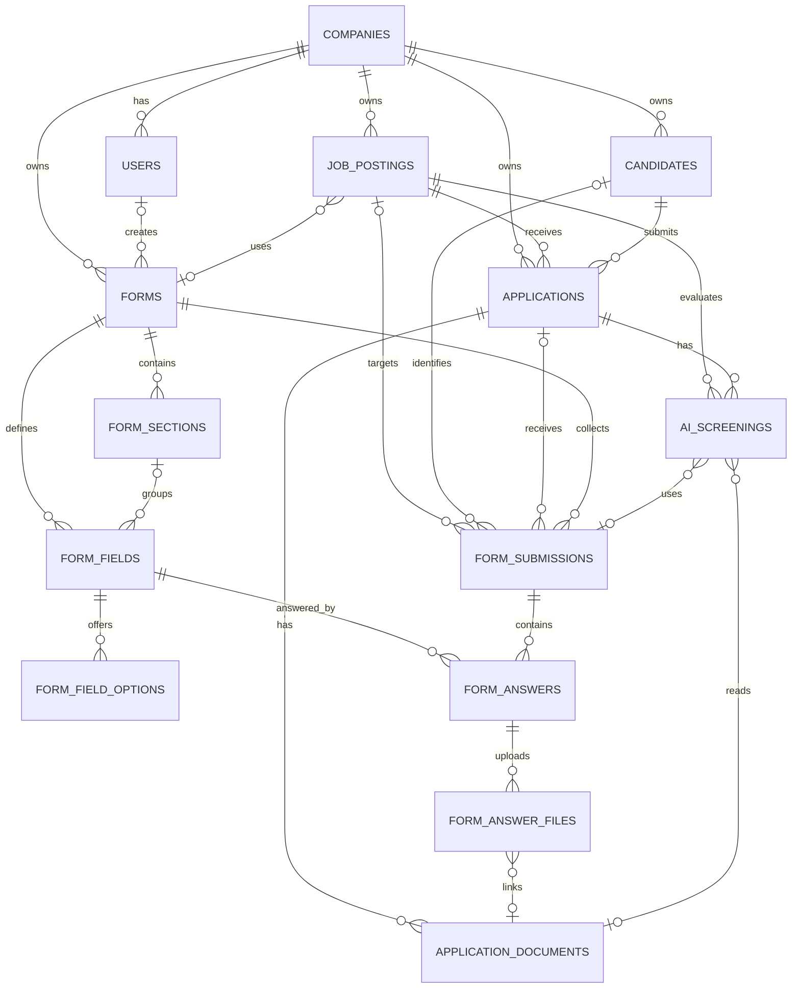

# Database Schema

This document describes the application's database schema, its relationships,
and the conventions used by the migrations and Eloquent models.

- **Database:** PostgreSQL (configured through `DB_CONNECTION=pgsql`)
- **Source of truth:** migrations in `database/migrations/`
- **Last verified:** 2026-11-04
- **Architecture context:** [architecture.md](architecture.md)

## Contents

- [1. Conventions](#1-conventions)
  - [1.1 Table map](#11-table-map)
- [2. Entity relationship diagram](#2-entity-relationship-diagram)
- [3. Table reference](#3-table-reference)
  - [3.1 Tenancy and identity](#31-tenancy-and-identity)
  - [3.2 Jobs and applications](#32-jobs-and-applications)
  - [3.3 Documents and AI](#33-documents-and-ai)
  - [3.4 Forms](#34-forms)
  - [3.5 Ingestion and audit](#35-ingestion-and-audit)
  - [3.6 Framework tables](#36-framework-tables)
- [4. Status and type values](#4-status-and-type-values)
- [5. Delete behavior](#5-delete-behavior)
- [6. Model map](#6-model-map)
- [7. Data flows](#7-data-flows)
  - [7.1 Form and document application](#71-form-and-document-application)
  - [7.2 Form-only and document-only screening](#72-form-only-and-document-only-screening)
  - [7.3 Email ingestion](#73-email-ingestion)
- [8. Operational notes](#8-operational-notes)
- [9. Migrations and seeding](#9-migrations-and-seeding)
  - [Migration order](#migration-order)
  - [Local setup](#local-setup)
- [10. Known limitations and future work](#10-known-limitations-and-future-work)

## 1. Conventions

- Primary keys are auto-incrementing `bigint` columns named `id`.
- Foreign keys use the `{model}_id` convention.
- Tenant-owned top-level records carry `company_id`.
- `created_at` and `updated_at` are nullable timestamps unless noted.
- JSON data is stored in PostgreSQL `json` columns and cast to arrays by models.
- Status, type, plan, source, and role values are strings. They are **not**
  database enums; the allowed values are enforced by application code and
  documented in [section 4](#4-status-and-type-values).
- Company scoping is not enforced by the database. Every query that reads or
  writes tenant data must apply `company_id` scoping explicitly.
- The recruitment vacancy table is `job_postings`, not `jobs`. Laravel's
  database queue uses `queue_jobs`, configured through `DB_QUEUE_TABLE`.
- There are no soft-delete columns. Deletion behavior is controlled by foreign
  key actions; see [section 5](#5-delete-behavior).

### 1.1 Table map

| Table | Domain | Purpose |
| --- | --- | --- |
| `companies` | Tenancy | Company/tenant record |
| `users` | Tenancy | Admin, HR, interviewer, and viewer accounts |
| `job_postings` | Jobs | Recruitment vacancies and requirements |
| `candidates` | Jobs | Candidate profiles |
| `applications` | Jobs | A candidate's application to a job |
| `application_documents` | Documents & AI | Resumes, cover letters, portfolios, parsed text |
| `ai_screenings` | Documents & AI | AI scores, recommendations, and screening history |
| `forms` | Forms | Google Forms-style form definitions |
| `form_sections` | Forms | Form pages/sections |
| `form_fields` | Forms | Questions and field configuration |
| `form_field_options` | Forms | Choices for selectable fields |
| `form_submissions` | Forms | Submitted form responses |
| `form_answers` | Forms | One answer per field per submission |
| `form_answer_files` | Forms | File-upload answers |
| `email_messages` | Ingestion | Gmail ingestion and processing state |
| `activity_logs` | Audit | Append-only activity history |
| `settings` | Audit | Global key/value settings |
| `password_reset_tokens` | Framework | Password reset tokens |
| `sessions` | Framework | Database-backed sessions |
| `cache` | Framework | Database cache store |
| `cache_locks` | Framework | Atomic cache locks |
| `queue_jobs` | Framework | Database queue |
| `job_batches` | Framework | Batched queue jobs |
| `failed_jobs` | Framework | Failed queue jobs |

## 2. Entity relationship diagram



## 3. Table reference

### 3.1 Tenancy and identity

#### `companies`

**Model:** `App\Models\Company`

| Column | Type | Null | Default | Notes |
| --- | --- | --- | --- | --- |
| `id` | bigint | no | auto | Primary key |
| `name` | varchar(255) | no | — | Company display name |
| `slug` | varchar(255) | no | — | Unique company identifier |
| `plan` | varchar(255) | no | `free` | `free`, `pro`, `enterprise` |
| `created_at` | timestamp | yes | — | |
| `updated_at` | timestamp | yes | — | |

**Indexes / constraints**

- `companies_pkey` on `id`
- `companies_slug_unique` on `slug`

**Relationships**

- `users()`, `jobPostings()`, `candidates()`, `applications()`, `forms()`

#### `users`

**Model:** `App\Models\User`

| Column | Type | Null | Default | Notes |
| --- | --- | --- | --- | --- |
| `id` | bigint | no | auto | Primary key |
| `name` | varchar(255) | no | — | |
| `email` | varchar(255) | no | — | Unique login email |
| `email_verified_at` | timestamp | yes | — | Laravel email verification |
| `password` | varchar(255) | no | — | Hashed password |
| `remember_token` | varchar(100) | yes | — | Laravel "remember me" token |
| `created_at` | timestamp | yes | — | |
| `updated_at` | timestamp | yes | — | |
| `company_id` | bigint | no | — | FK to `companies.id`, `RESTRICT` |
| `role` | varchar(255) | no | `viewer` | `admin`, `hr`, `interviewer`, `viewer` |

**Indexes / constraints**

- `users_pkey` on `id`
- `users_email_unique` on `email`
- `users_company_id_index` on `company_id`
- `users_company_id_foreign` → `companies.id`, `ON DELETE RESTRICT`

**Relationships**

- `company()`
- `reviewedApplications()` via `applications.reviewed_by`
- `activityLogs()`
- `createdForms()` via `forms.created_by`

> `company_id` is required. `UserFactory` creates a company automatically when
> no company is supplied.

### 3.2 Jobs and applications

#### `job_postings`

**Model:** `App\Models\JobPosting`

| Column | Type | Null | Default | Notes |
| --- | --- | --- | --- | --- |
| `id` | bigint | no | auto | Primary key |
| `company_id` | bigint | no | — | FK to `companies.id`, `RESTRICT` |
| `form_id` | bigint | yes | — | FK to `forms.id`, `SET NULL`; application form |
| `title` | varchar(255) | no | — | |
| `department` | varchar(255) | yes | — | |
| `location` | varchar(255) | yes | — | |
| `status` | varchar(255) | no | `draft` | `draft`, `open`, `closed` |
| `description` | text | no | — | |
| `requirements` | text | yes | — | |
| `required_skills` | json | no | — | Array of required skill names |
| `nice_to_have` | json | yes | — | Array of optional skill names |
| `min_experience_years` | integer | yes | — | |
| `created_at` | timestamp | yes | — | |
| `updated_at` | timestamp | yes | — | |

**Indexes / constraints**

- `job_postings_pkey` on `id`
- `job_postings_company_id_index` on `company_id`
- `job_postings_company_id_status_index` on `(company_id, status)`
- `job_postings_form_id_index` on `form_id`
- FKs: `company_id` → `companies.id` (`RESTRICT`), `form_id` → `forms.id` (`SET NULL`)

**Relationships**

- `company()`, `applications()`, `aiScreenings()`, `form()`, `formSubmissions()`

> `applications.job_id` and `ai_screenings.job_id` both point here. A form is
> reusable: multiple job postings may reference the same form.

#### `candidates`

**Model:** `App\Models\Candidate`

| Column | Type | Null | Default | Notes |
| --- | --- | --- | --- | --- |
| `id` | bigint | no | auto | Primary key |
| `company_id` | bigint | no | — | FK to `companies.id`, `RESTRICT` |
| `full_name` | varchar(255) | no | — | |
| `email` | varchar(255) | no | — | Indexed, not unique |
| `phone` | varchar(255) | yes | — | |
| `linkedin_url` | varchar(255) | yes | — | |
| `portfolio_url` | varchar(255) | yes | — | |
| `source` | varchar(255) | no | `manual` | `form`, `gmail`, `manual`, `import` |
| `source_meta` | json | yes | — | Source-specific metadata |
| `notes` | text | yes | — | |
| `created_at` | timestamp | yes | — | |
| `updated_at` | timestamp | yes | — | |

**Indexes / constraints**

- `candidates_pkey` on `id`
- `candidates_company_id_index` on `company_id`
- `candidates_email_index` on `email`
- `candidates_company_id_foreign` → `companies.id` (`RESTRICT`)

**Relationships**

- `company()`, `applications()`, `emailMessages()`, `activityLogs()`,
  `formSubmissions()`

> Email is intentionally not unique. Imports and multiple sources can produce
> duplicate candidates; deduplication is an application-level concern.

#### `applications`

**Model:** `App\Models\Application`

| Column | Type | Null | Default | Notes |
| --- | --- | --- | --- | --- |
| `id` | bigint | no | auto | Primary key |
| `company_id` | bigint | no | — | FK to `companies.id`, `RESTRICT` |
| `candidate_id` | bigint | no | — | FK to `candidates.id`, `RESTRICT` |
| `job_id` | bigint | no | — | FK to `job_postings.id`, `RESTRICT` |
| `source` | varchar(255) | no | `manual` | `form`, `gmail`, `manual` |
| `status` | varchar(255) | no | `received` | See status values below |
| `latest_match_score` | integer | yes | — | Denormalized latest AI score |
| `latest_ai_status` | varchar(255) | yes | — | Denormalized latest AI status |
| `latest_ai_at` | timestamp | yes | — | Denormalized latest AI timestamp |
| `submitted_at` | timestamp | no | — | When the application was submitted |
| `reviewed_at` | timestamp | yes | — | |
| `reviewed_by` | bigint | yes | — | FK to `users.id`, `SET NULL` |
| `notes` | text | yes | — | Recruiter notes |
| `created_at` | timestamp | yes | — | |
| `updated_at` | timestamp | yes | — | |

**Indexes / constraints**

- `applications_pkey` on `id`
- Indexes on `company_id`, `candidate_id`, `job_id`, `reviewed_by`
- `applications_company_id_status_index` on `(company_id, status)`
- `applications_submitted_at_index` on `submitted_at`
- FKs: `company_id` → `companies.id` (`RESTRICT`),
  `candidate_id` → `candidates.id` (`RESTRICT`),
  `job_id` → `job_postings.id` (`RESTRICT`),
  `reviewed_by` → `users.id` (`SET NULL`)

**Relationships**

- `company()`, `candidate()`, `job()`, `reviewer()`
- `documents()`, `aiScreenings()`, `emailMessages()`, `activityLogs()`,
  `formSubmissions()`

> `latest_match_score`, `latest_ai_status`, and `latest_ai_at` are a cache for
> list views. The authoritative screening history is in `ai_screenings`.
>
> There is no unique constraint on `(candidate_id, job_id)`. If duplicate
> applications must be prevented, enforce it in the application service.

### 3.3 Documents and AI

#### `application_documents`

**Model:** `App\Models\ApplicationDocument`

| Column | Type | Null | Default | Notes |
| --- | --- | --- | --- | --- |
| `id` | bigint | no | auto | Primary key |
| `application_id` | bigint | no | — | FK to `applications.id`, `RESTRICT` |
| `type` | varchar(255) | no | — | `resume`, `cover_letter`, `portfolio` |
| `file_name` | varchar(255) | no | — | Original file name |
| `file_path` | varchar(255) | no | — | Storage path |
| `mime_type` | varchar(255) | yes | — | |
| `size_bytes` | bigint | yes | — | File size |
| `parsing_status` | varchar(255) | no | `pending` | `pending`, `success`, `failed` |
| `parsed_text` | text | yes | — | Extracted text for AI input |
| `error_message` | text | yes | — | Parsing failure reason |
| `created_at` | timestamp | yes | — | |
| `updated_at` | timestamp | yes | — | |

**Indexes / constraints**

- `application_documents_pkey` on `id`
- `application_documents_application_id_index` on `application_id`
- `application_documents_application_id_foreign` → `applications.id`
  (`RESTRICT`)

**Relationships**

- `application()`, `aiScreenings()`, `formAnswerFiles()`

#### `ai_screenings`

**Model:** `App\Models\AiScreening`

| Column | Type | Null | Default | Notes |
| --- | --- | --- | --- | --- |
| `id` | bigint | no | auto | Primary key |
| `application_id` | bigint | no | — | FK to `applications.id`, `RESTRICT` |
| `job_id` | bigint | no | — | FK to `job_postings.id`, `RESTRICT` |
| `form_submission_id` | bigint | yes | — | FK to `form_submissions.id`, `SET NULL` |
| `document_id` | bigint | yes | — | Primary document, FK `SET NULL` |
| `model_name` | varchar(255) | no | — | e.g. `qwen2.5:7b` |
| `status` | varchar(255) | no | `queued` | `queued`, `running`, `success`, `failed` |
| `prompt_text` | text | no | — | Prompt sent to the model |
| `input_snapshot` | json | yes | — | Exact form answers, document refs, job snapshot |
| `raw_response` | text | yes | — | Raw model response |
| `parsed_response` | json | yes | — | Structured model response |
| `match_score` | integer | yes | — | `0`–`100` |
| `recommendation` | varchar(255) | yes | — | `strong_match`, `shortlist`, `review`, `reject` |
| `summary` | text | yes | — | Human-readable explanation |
| `candidate_skills` | json | yes | — | All skills found by the model |
| `matched_skills` | json | yes | — | Skills matching the job requirements |
| `missing_skills` | json | yes | — | Required skills missing from the input |
| `experience_years` | integer | yes | — | |
| `education_level` | varchar(255) | yes | — | |
| `risk_flags` | json | yes | — | Concerns detected by the model |
| `error_message` | text | yes | — | Failure reason |
| `started_at` | timestamp | yes | — | |
| `completed_at` | timestamp | yes | — | |
| `duration_ms` | integer | yes | — | Processing duration |
| `created_at` | timestamp | yes | — | |
| `updated_at` | timestamp | yes | — | |

**Indexes / constraints**

- `ai_screenings_pkey` on `id`
- Indexes on `application_id`, `job_id`, `form_submission_id`, `document_id`
- `ai_screenings_application_id_status_index` on `(application_id, status)`
- FKs: `application_id` → `applications.id` (`RESTRICT`),
  `job_id` → `job_postings.id` (`RESTRICT`),
  `form_submission_id` → `form_submissions.id` (`SET NULL`),
  `document_id` → `application_documents.id` (`SET NULL`)

**Relationships**

- `application()`, `job()`, `formSubmission()`, `document()`

> All three input combinations are supported: form only, document only, or
> form + document. `input_snapshot` makes each run replayable even if the form,
> answers, or documents change later.
>
> `document_id` is the primary document. The screening service may also read all
> documents belonging to the application.

### 3.4 Forms

#### `forms`

**Model:** `App\Models\Form`

| Column | Type | Null | Default | Notes |
| --- | --- | --- | --- | --- |
| `id` | bigint | no | auto | Primary key |
| `company_id` | bigint | no | — | FK to `companies.id`, `RESTRICT` |
| `created_by` | bigint | yes | — | FK to `users.id`, `SET NULL` |
| `title` | varchar(255) | no | — | |
| `description` | text | yes | — | |
| `status` | varchar(255) | no | `draft` | `draft`, `published`, `closed` |
| `version` | unsigned integer | no | `1` | Logical form version |
| `settings` | json | yes | — | Confirmation message, limits, redirect URL, etc. |
| `published_at` | timestamp | yes | — | |
| `closes_at` | timestamp | yes | — | |
| `created_at` | timestamp | yes | — | |
| `updated_at` | timestamp | yes | — | |

**Indexes / constraints**

- `forms_pkey` on `id`
- `forms_company_id_index` on `company_id`
- `forms_created_by_index` on `created_by`
- `forms_company_id_status_index` on `(company_id, status)`
- FKs: `company_id` → `companies.id` (`RESTRICT`),
  `created_by` → `users.id` (`SET NULL`)

**Relationships**

- `company()`, `creator()`, `sections()`, `fields()`, `submissions()`,
  `jobPostings()`

#### `form_sections`

**Model:** `App\Models\FormSection`

| Column | Type | Null | Default | Notes |
| --- | --- | --- | --- | --- |
| `id` | bigint | no | auto | Primary key |
| `form_id` | bigint | no | — | FK to `forms.id`, `CASCADE` |
| `title` | varchar(255) | no | — | |
| `description` | text | yes | — | |
| `sort_order` | unsigned integer | no | `0` | Display order |
| `created_at` | timestamp | yes | — | |
| `updated_at` | timestamp | yes | — | |

**Indexes / constraints**

- `form_sections_pkey` on `id`
- `form_sections_form_id_index` on `form_id`
- `form_sections_form_id_sort_order_index` on `(form_id, sort_order)`
- `form_sections_form_id_foreign` → `forms.id` (`CASCADE`)

**Relationships**

- `form()`, `fields()`

#### `form_fields`

**Model:** `App\Models\FormField`

| Column | Type | Null | Default | Notes |
| --- | --- | --- | --- | --- |
| `id` | bigint | no | auto | Primary key |
| `form_id` | bigint | no | — | FK to `forms.id`, `CASCADE` |
| `form_section_id` | bigint | yes | — | FK to `form_sections.id`, `SET NULL` |
| `field_key` | varchar(255) | no | — | Stable answer/export key |
| `label` | varchar(255) | no | — | Question label |
| `type` | varchar(255) | no | — | See field types below |
| `help_text` | text | yes | — | |
| `placeholder` | varchar(255) | yes | — | |
| `is_required` | boolean | no | `false` | |
| `validation` | json | yes | — | Min/max, regex, file constraints, etc. |
| `conditional_logic` | json | yes | — | Visibility rules |
| `default_value` | json | yes | — | |
| `maps_to` | varchar(255) | yes | — | e.g. `candidate.full_name`, `candidate.email` |
| `sort_order` | unsigned integer | no | `0` | Display order |
| `created_at` | timestamp | yes | — | |
| `updated_at` | timestamp | yes | — | |

**Indexes / constraints**

- `form_fields_pkey` on `id`
- `form_fields_form_id_index` on `form_id`
- `form_fields_form_section_id_index` on `form_section_id`
- `form_fields_form_id_field_key_unique` on `(form_id, field_key)`
- `form_fields_form_id_sort_order_index` on `(form_id, sort_order)`
- FKs: `form_id` → `forms.id` (`CASCADE`),
  `form_section_id` → `form_sections.id` (`SET NULL`)

**Relationships**

- `form()`, `section()`, `options()`, `answers()`

#### `form_field_options`

**Model:** `App\Models\FormFieldOption`

| Column | Type | Null | Default | Notes |
| --- | --- | --- | --- | --- |
| `id` | bigint | no | auto | Primary key |
| `form_field_id` | bigint | no | — | FK to `form_fields.id`, `CASCADE` |
| `label` | varchar(255) | no | — | Display label |
| `value` | varchar(255) | no | — | Stored value |
| `sort_order` | unsigned integer | no | `0` | Display order |
| `created_at` | timestamp | yes | — | |
| `updated_at` | timestamp | yes | — | |

**Indexes / constraints**

- `form_field_options_pkey` on `id`
- `form_field_options_form_field_id_index` on `form_field_id`
- `form_field_options_form_field_id_value_unique` on `(form_field_id, value)`
- `form_field_options_form_field_id_sort_order_index` on
  `(form_field_id, sort_order)`
- `form_field_options_form_field_id_foreign` → `form_fields.id` (`CASCADE`)

**Relationships**

- `field()`

#### `form_submissions`

**Model:** `App\Models\FormSubmission`

| Column | Type | Null | Default | Notes |
| --- | --- | --- | --- | --- |
| `id` | bigint | no | auto | Primary key |
| `form_id` | bigint | no | — | FK to `forms.id`, `RESTRICT` |
| `job_posting_id` | bigint | yes | — | FK to `job_postings.id`, `SET NULL` |
| `candidate_id` | bigint | yes | — | FK to `candidates.id`, `SET NULL` |
| `application_id` | bigint | yes | — | FK to `applications.id`, `SET NULL` |
| `status` | varchar(255) | no | `submitted` | `draft`, `submitted`, `processed`, `spam` |
| `schema_snapshot` | json | yes | — | Form structure at submission time |
| `meta` | json | yes | — | IP address, user agent, referrer, UTM data |
| `submitted_at` | timestamp | yes | — | |
| `created_at` | timestamp | yes | — | |
| `updated_at` | timestamp | yes | — | |

**Indexes / constraints**

- `form_submissions_pkey` on `id`
- Indexes on `form_id`, `job_posting_id`, `candidate_id`, `application_id`
- `form_submissions_form_id_status_index` on `(form_id, status)`
- `form_submissions_submitted_at_index` on `submitted_at`
- FKs: `form_id` → `forms.id` (`RESTRICT`),
  `job_posting_id` → `job_postings.id` (`SET NULL`),
  `candidate_id` → `candidates.id` (`SET NULL`),
  `application_id` → `applications.id` (`SET NULL`)

**Relationships**

- `form()`, `jobPosting()`, `candidate()`, `application()`, `answers()`,
  `aiScreenings()`

> `form_id` is `RESTRICT`, so a form with submissions cannot be deleted. This
> protects submitted responses for audit.

#### `form_answers`

**Model:** `App\Models\FormAnswer`

| Column | Type | Null | Default | Notes |
| --- | --- | --- | --- | --- |
| `id` | bigint | no | auto | Primary key |
| `form_submission_id` | bigint | no | — | FK to `form_submissions.id`, `CASCADE` |
| `form_field_id` | bigint | no | — | FK to `form_fields.id`, `RESTRICT` |
| `value` | json | yes | — | Scalar or array depending on field type |
| `created_at` | timestamp | yes | — | |
| `updated_at` | timestamp | yes | — | |

**Indexes / constraints**

- `form_answers_pkey` on `id`
- Indexes on `form_submission_id`, `form_field_id`
- `form_answers_form_submission_id_form_field_id_unique` on
  `(form_submission_id, form_field_id)`
- FKs: `form_submission_id` → `form_submissions.id` (`CASCADE`),
  `form_field_id` → `form_fields.id` (`RESTRICT`)

**Relationships**

- `submission()`, `field()`, `files()`

> One answer row per field per submission. Store multi-select answers as a JSON
> array; store single-value answers as a JSON scalar.

#### `form_answer_files`

**Model:** `App\Models\FormAnswerFile`

| Column | Type | Null | Default | Notes |
| --- | --- | --- | --- | --- |
| `id` | bigint | no | auto | Primary key |
| `form_answer_id` | bigint | no | — | FK to `form_answers.id`, `CASCADE` |
| `application_document_id` | bigint | yes | — | FK to `application_documents.id`, `SET NULL` |
| `file_name` | varchar(255) | no | — | |
| `file_path` | varchar(255) | no | — | |
| `mime_type` | varchar(255) | yes | — | |
| `size_bytes` | bigint | yes | — | |
| `created_at` | timestamp | yes | — | |
| `updated_at` | timestamp | yes | — | |

**Indexes / constraints**

- `form_answer_files_pkey` on `id`
- Indexes on `form_answer_id`, `application_document_id`
- FKs: `form_answer_id` → `form_answers.id` (`CASCADE`),
  `application_document_id` → `application_documents.id` (`SET NULL`)

**Relationships**

- `answer()`, `applicationDocument()`

> File metadata is stored here so uploads can exist before an application is
> created. Once the application document exists, link it through
> `application_document_id`.

### 3.5 Ingestion and audit

#### `email_messages`

**Model:** `App\Models\EmailMessage`

| Column | Type | Null | Default | Notes |
| --- | --- | --- | --- | --- |
| `id` | bigint | no | auto | Primary key |
| `message_id` | varchar(255) | no | — | Unique Gmail message ID |
| `from_email` | varchar(255) | no | — | |
| `subject` | varchar(255) | no | — | |
| `has_attachment` | boolean | no | `false` | |
| `status` | varchar(255) | no | `received` | `received`, `processed`, `ignored`, `failed` |
| `candidate_id` | bigint | yes | — | FK to `candidates.id`, `SET NULL` |
| `application_id` | bigint | yes | — | FK to `applications.id`, `SET NULL` |
| `received_at` | timestamp | no | — | |
| `created_at` | timestamp | yes | — | |
| `updated_at` | timestamp | yes | — | |

**Indexes / constraints**

- `email_messages_pkey` on `id`
- `email_messages_message_id_unique` on `message_id`
- Indexes on `candidate_id`, `application_id`, `received_at`
- FKs: `candidate_id` → `candidates.id` (`SET NULL`),
  `application_id` → `applications.id` (`SET NULL`)

**Relationships**

- `candidate()`, `application()`

#### `activity_logs`

**Model:** `App\Models\ActivityLog`

| Column | Type | Null | Default | Notes |
| --- | --- | --- | --- | --- |
| `id` | bigint | no | auto | Primary key |
| `user_id` | bigint | yes | — | FK to `users.id`, `SET NULL` |
| `application_id` | bigint | yes | — | FK to `applications.id`, `SET NULL` |
| `candidate_id` | bigint | yes | — | FK to `candidates.id`, `SET NULL` |
| `action` | varchar(255) | no | — | `created`, `updated`, `ai_started`, `status_changed` |
| `description` | text | yes | — | |
| `meta` | json | yes | — | |
| `created_at` | timestamp | no | `CURRENT_TIMESTAMP` | Append-only |

**Indexes / constraints**

- `activity_logs_pkey` on `id`
- Indexes on `user_id`, `application_id`, `candidate_id`
- FKs: `user_id` → `users.id` (`SET NULL`),
  `application_id` → `applications.id` (`SET NULL`),
  `candidate_id` → `candidates.id` (`SET NULL`)

**Relationships**

- `user()`, `application()`, `candidate()`

> There is no `updated_at` column. The model sets `UPDATED_AT = null`.

#### `settings`

**Model:** `App\Models\Setting`

| Column | Type | Null | Default | Notes |
| --- | --- | --- | --- | --- |
| `id` | bigint | no | auto | Primary key |
| `key` | varchar(255) | no | — | Unique setting key |
| `value` | json | yes | — | Setting value |
| `created_at` | timestamp | yes | — | |
| `updated_at` | timestamp | yes | — | |

**Indexes / constraints**

- `settings_pkey` on `id`
- `settings_key_unique` on `key`

> Settings are global. If per-company settings are needed, add a nullable
> `company_id` and a unique constraint on `(company_id, key)`.

### 3.6 Framework tables

These are created by Laravel's default migrations and support the framework
runtime.

| Table | Key columns | Purpose |
| --- | --- | --- |
| `password_reset_tokens` | `email` (PK), `token`, `created_at` | Password reset tokens |
| `sessions` | `id` (PK), `user_id`, `ip_address`, `user_agent`, `payload`, `last_activity` | Database sessions |
| `cache` | `key` (PK), `value`, `expiration` | Database cache store |
| `cache_locks` | `key` (PK), `owner`, `expiration` | Atomic cache locks |
| `queue_jobs` | `id`, `queue`, `payload`, `attempts`, `reserved_at`, `available_at`, `created_at` | Database queue |
| `job_batches` | `id` (PK), `name`, `total_jobs`, `pending_jobs`, `failed_jobs`, `failed_job_ids`, `options`, `cancelled_at`, `created_at`, `finished_at` | Batched jobs |
| `failed_jobs` | `id`, `uuid` (unique), `connection`, `queue`, `payload`, `exception`, `failed_at` | Failed queue jobs |

> `sessions.user_id` is indexed but has no foreign key constraint. This matches
> Laravel's default session migration.
>
> The queue table is `queue_jobs`, not `jobs`. `config/queue.php` and
> `.env.example` use `DB_QUEUE_TABLE=queue_jobs`.

## 4. Status and type values

These are application-enforced string values, not database enums.

| Table.column | Allowed values |
| --- | --- |
| `companies.plan` | `free`, `pro`, `enterprise` |
| `users.role` | `admin`, `hr`, `interviewer`, `viewer` |
| `job_postings.status` | `draft`, `open`, `closed` |
| `candidates.source` | `form`, `gmail`, `manual`, `import` |
| `applications.source` | `form`, `gmail`, `manual` |
| `applications.status` | `received`, `queued`, `parsing`, `analyzing`, `scored`, `failed`, `shortlisted`, `rejected`, `interview`, `hired`, `archived` |
| `application_documents.type` | `resume`, `cover_letter`, `portfolio` |
| `application_documents.parsing_status` | `pending`, `success`, `failed` |
| `ai_screenings.status` | `queued`, `running`, `success`, `failed` |
| `ai_screenings.recommendation` | `strong_match`, `shortlist`, `review`, `reject` |
| `forms.status` | `draft`, `published`, `closed` |
| `form_submissions.status` | `draft`, `submitted`, `processed`, `spam` |
| `email_messages.status` | `received`, `processed`, `ignored`, `failed` |
| `activity_logs.action` | `created`, `updated`, `ai_started`, `status_changed` |
| `form_fields.type` | `short_text`, `paragraph`, `multiple_choice`, `checkboxes`, `dropdown`, `file_upload`, `date`, `time`, `email`, `number`, `url`, `phone`, `linear_scale` |

## 5. Delete behavior

| Relationship | On delete | Why |
| --- | --- | --- |
| `users.company_id` → `companies` | `RESTRICT` | A company with users cannot be deleted |
| `job_postings.company_id` → `companies` | `RESTRICT` | A company with jobs cannot be deleted |
| `candidates.company_id` → `companies` | `RESTRICT` | A company with candidates cannot be deleted |
| `applications.company_id` → `companies` | `RESTRICT` | A company with applications cannot be deleted |
| `forms.company_id` → `companies` | `RESTRICT` | A company with forms cannot be deleted |
| `applications.candidate_id` → `candidates` | `RESTRICT` | Preserve applications |
| `applications.job_id` → `job_postings` | `RESTRICT` | Preserve applications |
| `applications.reviewed_by` → `users` | `SET NULL` | Keep application if reviewer is deleted |
| `application_documents.application_id` → `applications` | `RESTRICT` | Preserve documents |
| `ai_screenings.application_id` → `applications` | `RESTRICT` | Preserve screening history |
| `ai_screenings.job_id` → `job_postings` | `RESTRICT` | Preserve screening history |
| `ai_screenings.form_submission_id` → `form_submissions` | `SET NULL` | Keep screening if submission is removed |
| `ai_screenings.document_id` → `application_documents` | `SET NULL` | Keep screening if document is removed |
| `forms.created_by` → `users` | `SET NULL` | Keep form if creator is deleted |
| `form_sections.form_id` → `forms` | `CASCADE` | Sections belong to a form |
| `form_fields.form_id` → `forms` | `CASCADE` | Fields belong to a form |
| `form_fields.form_section_id` → `form_sections` | `SET NULL` | Keep fields if a section is removed |
| `form_field_options.form_field_id` → `form_fields` | `CASCADE` | Options belong to a field |
| `form_submissions.form_id` → `forms` | `RESTRICT` | Preserve submitted responses |
| `form_submissions.job_posting_id` → `job_postings` | `SET NULL` | Keep response if job is removed |
| `form_submissions.candidate_id` → `candidates` | `SET NULL` | Keep response if candidate is removed |
| `form_submissions.application_id` → `applications` | `SET NULL` | Keep response if application is removed |
| `form_answers.form_submission_id` → `form_submissions` | `CASCADE` | Answers belong to a submission |
| `form_answers.form_field_id` → `form_fields` | `RESTRICT` | Preserve answers when a field is removed |
| `form_answer_files.form_answer_id` → `form_answers` | `CASCADE` | Files belong to an answer |
| `form_answer_files.application_document_id` → `application_documents` | `SET NULL` | Keep upload record if document is removed |
| `job_postings.form_id` → `forms` | `SET NULL` | Keep job if form is removed |
| `email_messages.candidate_id` → `candidates` | `SET NULL` | Keep message history |
| `email_messages.application_id` → `applications` | `SET NULL` | Keep message history |
| `activity_logs.user_id` → `users` | `SET NULL` | Keep audit history |
| `activity_logs.application_id` → `applications` | `SET NULL` | Keep audit history |
| `activity_logs.candidate_id` → `candidates` | `SET NULL` | Keep audit history |

## 6. Model map

| Model | Table | Main relationships |
| --- | --- | --- |
| `Company` | `companies` | users, job postings, candidates, applications, forms |
| `User` | `users` | company, reviewed applications, activity logs, created forms |
| `JobPosting` | `job_postings` | company, form, applications, form submissions, AI screenings |
| `Candidate` | `candidates` | company, applications, form submissions, email messages, activity logs |
| `Application` | `applications` | company, candidate, job, reviewer, documents, AI screenings, form submissions, email messages, activity logs |
| `ApplicationDocument` | `application_documents` | application, AI screenings, form answer files |
| `AiScreening` | `ai_screenings` | application, job, form submission, document |
| `Form` | `forms` | company, creator, sections, fields, submissions, job postings |
| `FormSection` | `form_sections` | form, fields |
| `FormField` | `form_fields` | form, section, options, answers |
| `FormFieldOption` | `form_field_options` | field |
| `FormSubmission` | `form_submissions` | form, job posting, candidate, application, answers, AI screenings |
| `FormAnswer` | `form_answers` | submission, field, files |
| `FormAnswerFile` | `form_answer_files` | answer, application document |
| `EmailMessage` | `email_messages` | candidate, application |
| `ActivityLog` | `activity_logs` | user, application, candidate |
| `Setting` | `settings` | — |

## 7. Data flows

### 7.1 Form and document application

```text
HR creates job posting
  └── attaches form through job_postings.form_id

Candidate submits form
  ├── form_submissions
  ├── form_answers
  └── form_answer_files

Application service
  ├── maps answers through form_fields.maps_to
  ├── creates or updates candidates
  ├── creates applications
  └── links form_submissions.application_id

Document pipeline
  ├── copies uploads into application_documents
  ├── sets parsing_status
  └── stores parsed_text

AI screening pipeline
  ├── reads job requirements, form answers, and parsed documents
  ├── writes ai_screenings
  │     ├── input_snapshot (form answers + document refs + job snapshot)
  │     ├── match_score and recommendation
  │     ├── matched_skills and missing_skills
  │     └── raw_response and parsed_response
  └── updates applications.latest_match_score / latest_ai_status / latest_ai_at

HR review
  ├── applications.reviewed_by / reviewed_at
  ├── applications.status
  └── activity_logs
```

### 7.2 Form-only and document-only screening

| Input | `ai_screenings.form_submission_id` | `ai_screenings.document_id` |
| --- | --- | --- |
| Form only | set | null |
| Document only | null | set |
| Form + document | set | set |

### 7.3 Email ingestion

`email_messages` stores the Gmail message ID, sender, subject, attachment flag,
and processing status. Once processed, it can be linked to the candidate and
application it produced. Uploaded attachments become `application_documents`.

## 8. Operational notes

- **Company scoping:** enforce it in services, repositories, and policies.
  The schema does not use PostgreSQL row-level security. Child tables such as
  `application_documents`, `ai_screenings`, `form_submissions`, `form_answers`,
  `form_answer_files`, `email_messages`, and `activity_logs` do not carry
  `company_id`; scope them through their parent records.
- **JSON columns:** PostgreSQL `json` is used. If you need indexed JSON queries,
  consider migrating selected columns to `jsonb` later.
- **Denormalized AI fields:** `applications.latest_*` is a cache for list views;
  `ai_screenings` is the source of truth.
- **Audit snapshots:** `form_submissions.schema_snapshot` and
  `ai_screenings.input_snapshot` preserve the structure and input used at the
  time of submission/screening.
- **Duplicate applications:** no unique constraint prevents the same candidate
  from applying to the same job twice. Enforce it in the application service if
  required.
- **Duplicate candidates:** `candidates.email` is indexed but not unique.
  Deduplicate by normalized email within a company in application code.
- **Global settings:** `settings` has no `company_id`. Add one if settings must
  be tenant-specific.
- **Queue naming:** the queue table is `queue_jobs`; recruitment vacancies are
  `job_postings`. Do not create a domain table named `jobs`.
- **File storage:** `file_path` values are storage-relative paths. The actual
  disk is controlled by `config/filesystems.php`.
- **Indexes:** foreign keys used in common lookups are indexed. Add indexes for
  new query patterns as they appear.

## 9. Migrations and seeding

### Migration order

| Migration | Creates / changes |
| --- | --- |
| `0001_01_01_000000_create_users_table.php` | `users`, `password_reset_tokens`, `sessions` |
| `0001_01_01_000001_create_cache_table.php` | `cache`, `cache_locks` |
| `0001_01_01_000002_create_jobs_table.php` | `queue_jobs`, `job_batches`, `failed_jobs` |
| `2026_11_03_000001_create_hiring_schema.php` | companies, users columns, job postings, candidates, applications, documents, AI screenings, email messages, activity logs, settings |
| `2026_11_03_000002_create_form_schema.php` | forms, sections, fields, options, submissions, answers, files; adds `job_postings.form_id` |
| `2026_11_03_000003_add_form_inputs_to_ai_screenings.php` | adds `ai_screenings.form_submission_id` and `ai_screenings.input_snapshot` |

### Local setup

```bash
php artisan migrate
```

For a clean development database:

```bash
php artisan migrate:fresh --seed
```

`DatabaseSeeder` creates a demo company, admin user, job posting, candidate,
application, parsed document, form with sections/fields/options, form
submission with answers, uploaded file, and an AI screening with an input
snapshot.

## 10. Known limitations and future work

- Status/type values are not enforced by database constraints. Add PHP enums or
  validation rules if stronger guarantees are needed.
- Skills are stored as JSON. If HR needs filtering, reporting, or matching by
  skill, normalize them into a queryable table such as `candidate_skills` or
  `application_skills`.
- `ai_screenings.document_id` tracks one primary document. Multiple-document
  runs are represented through `input_snapshot` and the application's document
  collection. Add an explicit pivot table if per-run document membership must be
  queryable.
- Forms can be edited after publication. `version` is informational; there is no
  full field-history table. The submission snapshot protects submitted answers.
- There is no built-in form response editing or resubmission workflow. Use
  multiple `form_submissions` rows and link the relevant one to the application.
- `settings` is global, not per-company.
- There are no soft deletes. Deletion is protected by `RESTRICT` where audit
  history matters, but hard deletes still exist for child records.
