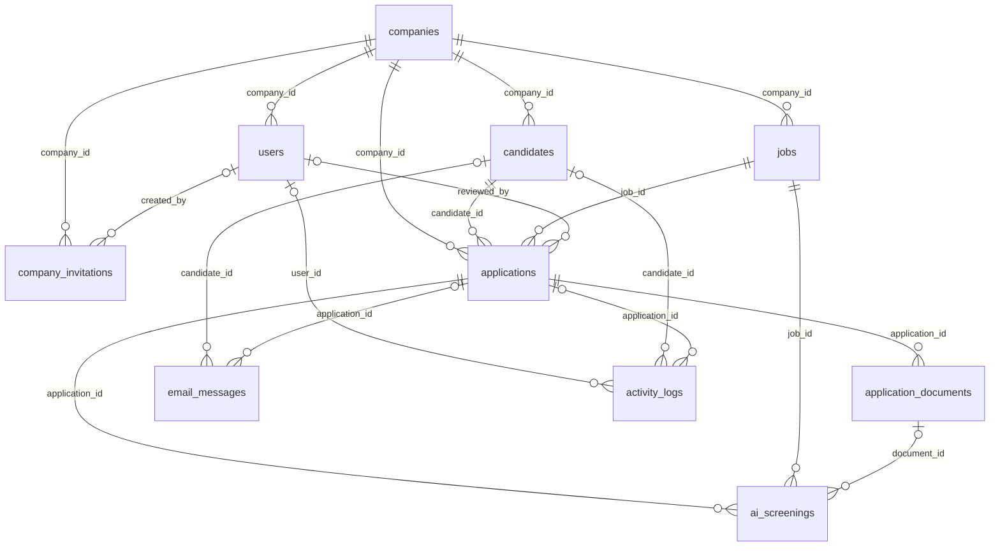

# Schema Model dan Database Roku

Dokumen ini merangkum struktur yang didefinisikan dalam `database/migrations/` dan model Eloquent di `app/Models/`. Ini adalah dokumentasi kode, bukan hasil pemeriksaan status migration pada database tertentu. Tidak ada migration yang dijalankan untuk membuat dokumen ini.

> Struktur rekrutmen sudah tersedia, tetapi keberadaan tabel bukan berarti pipeline Gmail, parsing CV, screening AI, atau integrasi Google Form sudah diimplementasikan.

## 1. Konvensi

- **PK**: primary key. Kolom `id` menggunakan `$table->id()` Laravel, yaitu identitas bigint auto-increment sesuai driver database.
- **FK**: foreign key. Semua FK yang dideklarasikan melalui `constrained()` juga memiliki indeks eksplisit pada kolomnya.
- `string` berarti panjang default 255 karakter, kecuali disebutkan berbeda.
- Kolom wajib berarti `NOT NULL`; kolom opsional ditandai **Ya** pada kolom Nullable.
- Tabel model memiliki `created_at` dan `updated_at` bertipe timestamp nullable dari `timestamps()`, kecuali `activity_logs`.
- `activity_logs` hanya memiliki `created_at`, wajib, dengan default waktu saat ini.
- Tipe ditulis mengikuti migration Laravel. Representasi fisik seperti unsigned integer, JSON, dan text dapat berbeda antara PostgreSQL, SQLite, dan MySQL.
- Daftar status, role, plan, dan rentang skor dalam komentar migration **bukan** enum SQL atau `CHECK` constraint.

## 2. Ringkasan Model

| Model | Tabel | Fungsi |
| --- | --- | --- |
| `Company` | `companies` | Perusahaan atau tenant |
| `User` | `users` | Akun anggota perusahaan |
| `CompanyInvitation` | `company_invitations` | Undangan registrasi anggota |
| `Job` | `jobs` | Lowongan rekrutmen, bukan antrean Laravel |
| `Candidate` | `candidates` | Profil kandidat |
| `Application` | `applications` | Lamaran kandidat untuk suatu lowongan |
| `ApplicationDocument` | `application_documents` | Berkas lamaran dan hasil parsing |
| `AiScreening` | `ai_screenings` | Riwayat penilaian AI |
| `EmailMessage` | `email_messages` | Metadata email masuk |
| `ActivityLog` | `activity_logs` | Catatan aktivitas |
| `Setting` | `settings` | Konfigurasi berbasis key/value |

## 3. Diagram Relasi Database

Diagram berikut menunjukkan FK database, termasuk relasi yang belum memiliki metode inverse pada model.

`||` berarti tepat satu parent wajib, `o|` berarti parent opsional, dan `o{` berarti nol atau banyak child. `settings` tidak memiliki FK.

## 4. Tabel Domain

Semua tabel di bagian ini memiliki timestamps standar yang dijelaskan pada bagian konvensi, kecuali jika disebutkan lain.

### 4.1 `companies`

| Kolom | Tipe | Nullable | Default / Keterangan |
| --- | --- | --- | --- |
| `id` | bigint | Tidak | PK |
| `name` | string | Tidak | Nama perusahaan |
| `slug` | string | Tidak | Unique |
| `plan` | string | Tidak | `free`; nilai yang didokumentasikan: `free`, `pro`, `enterprise` |

### 4.2 `users`

| Kolom | Tipe | Nullable | Default / Keterangan |
| --- | --- | --- | --- |
| `id` | bigint | Tidak | PK |
| `company_id` | foreignId | Tidak | FK → `companies.id`, indexed |
| `name` | string | Tidak | Nama pengguna |
| `email` | string | Tidak | Unique global, bukan per perusahaan |
| `email_verified_at` | timestamp | Ya | Waktu verifikasi email |
| `password` | string | Tidak | Hash password |
| `remember_token` | string(100) | Ya | Token remember-me |
| `role` | string | Tidak | `viewer`; nilai: `admin`, `hr`, `interviewer`, `viewer` |

### 4.3 `company_invitations`

| Kolom | Tipe | Nullable | Default / Keterangan |
| --- | --- | --- | --- |
| `id` | bigint | Tidak | PK |
| `company_id` | foreignId | Tidak | FK → `companies.id`, indexed |
| `created_by` | foreignId | Ya | FK → `users.id`, indexed |
| `email` | string | Tidak | Email penerima; tidak unique |
| `role` | string | Tidak | `viewer`; penerimaan undangan mengizinkan `hr`, `interviewer`, `viewer` |
| `token_hash` | string(64) | Tidak | Unique; hash SHA-256 token asli |
| `expires_at` | timestamp | Tidak | Batas kedaluwarsa |
| `accepted_at` | timestamp | Ya | Waktu pemakaian undangan |

Aturan aplikasi, bukan default SQL:

- Hanya admin perusahaan yang dapat membuat undangan melalui halaman pengelolaan.
- Token asli dibuat dengan `Str::random(64)` dan ditampilkan sebagai kode serta parameter `invitation` pada link Register.
- Database menyimpan `hash('sha256', $token)`, bukan token asli.
- Masa berlaku diatur menjadi tujuh hari saat pembuatan.
- Penerimaan memerlukan token cocok, email penerima cocok tanpa membedakan kapitalisasi, belum terpakai, belum kedaluwarsa, dan role yang diizinkan.
- Company dan role akun ditetapkan server-side dari undangan. `accepted_at` diisi dalam transaksi pembuatan akun, dengan row lock pada undangan.
- Alur ini untuk akun baru; bergabung menggunakan akun yang sudah terdaftar belum diimplementasikan.

### 4.4 `jobs`

| Kolom | Tipe | Nullable | Default / Keterangan |
| --- | --- | --- | --- |
| `id` | bigint | Tidak | PK |
| `company_id` | foreignId | Tidak | FK → `companies.id`, indexed |
| `title` | string | Tidak | Judul lowongan |
| `department` | string | Ya | Departemen |
| `location` | string | Ya | Lokasi |
| `status` | string | Tidak | `draft`; nilai: `draft`, `open`, `closed` |
| `description` | text | Tidak | Deskripsi pekerjaan |
| `requirements` | text | Ya | Persyaratan |
| `required_skills` | json | Tidak | Keterampilan wajib |
| `nice_to_have` | json | Ya | Keterampilan tambahan |
| `min_experience_years` | integer | Ya | Pengalaman minimum |

### 4.5 `candidates`

| Kolom | Tipe | Nullable | Default / Keterangan |
| --- | --- | --- | --- |
| `id` | bigint | Tidak | PK |
| `company_id` | foreignId | Tidak | FK → `companies.id`, indexed |
| `full_name` | string | Tidak | Nama kandidat |
| `email` | string | Tidak | Tidak memiliki unique constraint |
| `phone` | string | Ya | Nomor telepon |
| `linkedin_url` | string | Ya | URL LinkedIn |
| `portfolio_url` | string | Ya | URL portofolio |
| `source` | string | Tidak | `manual`; nilai: `form`, `gmail`, `manual`, `import` |
| `source_meta` | json | Ya | Metadata sumber kandidat |
| `notes` | text | Ya | Catatan |

### 4.6 `applications`

| Kolom | Tipe | Nullable | Default / Keterangan |
| --- | --- | --- | --- |
| `id` | bigint | Tidak | PK |
| `company_id` | foreignId | Tidak | FK → `companies.id`, indexed |
| `candidate_id` | foreignId | Tidak | FK → `candidates.id`, indexed |
| `job_id` | foreignId | Tidak | FK → `jobs.id`, indexed |
| `source` | string | Tidak | `manual`; nilai: `form`, `gmail`, `manual` |
| `status` | string | Tidak | `received`; daftar nilai di bawah |
| `latest_match_score` | integer | Ya | Skor terbaru |
| `latest_ai_status` | string | Ya | Status AI terbaru; tidak memiliki daftar nilai pada migration |
| `latest_ai_at` | timestamp | Ya | Waktu penilaian AI terbaru |
| `submitted_at` | timestamp | Tidak | Waktu pengajuan |
| `reviewed_at` | timestamp | Ya | Waktu review |
| `reviewed_by` | foreignId | Ya | FK → `users.id`, indexed |
| `notes` | text | Ya | Catatan lamaran |

Nilai `status` yang didokumentasikan: `received`, `queued`, `parsing`, `analyzing`, `scored`, `failed`, `shortlisted`, `rejected`, `interview`, `hired`, `archived`.

Tidak ada unique constraint gabungan `candidate_id` dan `job_id`; schema mengizinkan lebih dari satu lamaran untuk pasangan tersebut.

### 4.7 `application_documents`

| Kolom | Tipe | Nullable | Default / Keterangan |
| --- | --- | --- | --- |
| `id` | bigint | Tidak | PK |
| `application_id` | foreignId | Tidak | FK → `applications.id`, indexed |
| `type` | string | Tidak | `resume`, `cover_letter`, `portfolio` |
| `file_name` | string | Tidak | Nama berkas |
| `file_path` | string | Tidak | Lokasi berkas, bukan isi berkas |
| `mime_type` | string | Ya | Tipe MIME |
| `size_bytes` | bigInteger | Ya | Ukuran berkas |
| `parsing_status` | string | Tidak | `pending`; nilai: `pending`, `success`, `failed` |
| `parsed_text` | text | Ya | Teks hasil parsing |
| `error_message` | text | Ya | Pesan kegagalan parsing |

### 4.8 `ai_screenings`

| Kolom | Tipe | Nullable | Default / Keterangan |
| --- | --- | --- | --- |
| `id` | bigint | Tidak | PK |
| `application_id` | foreignId | Tidak | FK → `applications.id`, indexed |
| `job_id` | foreignId | Tidak | FK → `jobs.id`, indexed |
| `document_id` | foreignId | Ya | FK → `application_documents.id`, indexed |
| `model_name` | string | Tidak | Nama model AI |
| `status` | string | Tidak | `queued`; nilai: `queued`, `running`, `success`, `failed` |
| `prompt_text` | text | Tidak | Prompt yang digunakan |
| `raw_response` | text | Ya | Respons mentah |
| `parsed_response` | json | Ya | Respons terstruktur |
| `match_score` | integer | Ya | Didokumentasikan `0–100`, tanpa CHECK constraint |
| `recommendation` | string | Ya | `strong_match`, `shortlist`, `review`, `reject` |
| `summary` | text | Ya | Ringkasan penilaian |
| `candidate_skills` | json | Ya | Keterampilan kandidat |
| `matched_skills` | json | Ya | Keterampilan yang cocok |
| `missing_skills` | json | Ya | Keterampilan yang belum terpenuhi |
| `experience_years` | integer | Ya | Tahun pengalaman |
| `education_level` | string | Ya | Tingkat pendidikan |
| `risk_flags` | json | Ya | Penanda risiko |
| `error_message` | text | Ya | Pesan kegagalan |
| `started_at` | timestamp | Ya | Waktu mulai |
| `completed_at` | timestamp | Ya | Waktu selesai |
| `duration_ms` | integer | Ya | Durasi dalam milidetik |

Satu lamaran dapat memiliki banyak screening; tidak ada unique constraint pada `application_id`.

### 4.9 `email_messages`

| Kolom | Tipe | Nullable | Default / Keterangan |
| --- | --- | --- | --- |
| `id` | bigint | Tidak | PK |
| `message_id` | string | Tidak | Unique |
| `from_email` | string | Tidak | Email pengirim |
| `subject` | string | Tidak | Subjek email |
| `has_attachment` | boolean | Tidak | `false` |
| `status` | string | Tidak | `received`; nilai: `received`, `processed`, `ignored`, `failed` |
| `candidate_id` | foreignId | Ya | FK → `candidates.id`, indexed |
| `application_id` | foreignId | Ya | FK → `applications.id`, indexed |
| `received_at` | timestamp | Tidak | Waktu email diterima |

### 4.10 `activity_logs`

| Kolom | Tipe | Nullable | Default / Keterangan |
| --- | --- | --- | --- |
| `id` | bigint | Tidak | PK |
| `user_id` | foreignId | Ya | FK → `users.id`, indexed |
| `application_id` | foreignId | Ya | FK → `applications.id`, indexed |
| `candidate_id` | foreignId | Ya | FK → `candidates.id`, indexed |
| `action` | string | Tidak | Nilai yang didokumentasikan: `created`, `updated`, `ai_started`, `status_changed` |
| `description` | text | Ya | Deskripsi aktivitas |
| `meta` | json | Ya | Metadata |
| `created_at` | timestamp | Tidak | Waktu saat ini |

Tidak memiliki `updated_at`. Model menetapkan `UPDATED_AT = null`.

### 4.11 `settings`

| Kolom | Tipe | Nullable | Default / Keterangan |
| --- | --- | --- | --- |
| `id` | bigint | Tidak | PK |
| `key` | string | Tidak | Unique |
| `value` | json | Ya | Nilai konfigurasi |

Tidak memiliki `company_id`; konfigurasi ini bersifat global pada level schema.

## 5. Relasi Eloquent yang Tersedia

Nama di bawah adalah nama metode model, bukan nama tabel.

| Model | `belongsTo` | `hasMany` |
| --- | --- | --- |
| `Company` | — | `users`, `jobs`, `candidates`, `applications` |
| `User` | `company` | `reviewedApplications` melalui `reviewed_by`; `activityLogs` |
| `CompanyInvitation` | `company`; `creator` melalui `created_by` | — |
| `Job` | `company` | `applications`, `aiScreenings` |
| `Candidate` | `company` | `applications`, `emailMessages`, `activityLogs` |
| `Application` | `company`, `candidate`, `job`; `reviewer` melalui `reviewed_by` | `documents`, `aiScreenings`, `emailMessages`, `activityLogs` |
| `ApplicationDocument` | `application` | `aiScreenings` melalui `document_id` |
| `AiScreening` | `application`, `job`; `document` melalui `document_id` | — |
| `EmailMessage` | `candidate`, `application` | — |
| `ActivityLog` | `user`, `application`, `candidate` | — |
| `Setting` | — | — |

Belum ada metode inverse undangan pada `Company` maupun `User`, meskipun FK undangan tersedia di database.

## 6. Cast dan Perlindungan Model

| Model | Cast eksplisit |
| --- | --- |
| `Company` | Tidak ada |
| `User` | `company_id` → integer; `email_verified_at` → datetime; `password` → hashed |
| `CompanyInvitation` | `company_id`, `created_by` → integer; `expires_at`, `accepted_at` → datetime |
| `Job` | `company_id`, `min_experience_years` → integer; `required_skills`, `nice_to_have` → array |
| `Candidate` | `company_id` → integer; `source_meta` → array |
| `Application` | `company_id`, `candidate_id`, `job_id`, `latest_match_score`, `reviewed_by` → integer; `latest_ai_at`, `submitted_at`, `reviewed_at` → datetime |
| `ApplicationDocument` | `application_id`, `size_bytes` → integer |
| `AiScreening` | `application_id`, `job_id`, `document_id`, `match_score`, `experience_years`, `duration_ms` → integer; `parsed_response`, `candidate_skills`, `matched_skills`, `missing_skills`, `risk_flags` → array; `started_at`, `completed_at` → datetime |
| `EmailMessage` | `has_attachment` → boolean; `candidate_id`, `application_id` → integer; `received_at` → datetime |
| `ActivityLog` | `user_id`, `application_id`, `candidate_id` → integer; `meta` → array |
| `Setting` | `value` → array |

- Eloquent juga menangani PK dan timestamps sesuai konvensinya; tabel di atas hanya merangkum `casts()` eksplisit.
- `User` hanya mengizinkan mass assignment untuk `name`, `email`, `password`; `company_id` dan `role` ditetapkan secara eksplisit oleh aplikasi.
- `User` menyembunyikan `password` dan `remember_token` pada serialisasi.
- `CompanyInvitation` menyembunyikan `token_hash` dan tidak mendefinisikan daftar fillable; pembuatan saat ini menggunakan assignment properti langsung.
- Model domain lainnya mendefinisikan fillable untuk kolom bisnisnya, bukan PK dan timestamps.
- Semua model domain menggunakan `HasFactory`. Tidak ada model yang menggunakan `SoftDeletes` atau kolom `deleted_at`.

## 7. Aturan Penghapusan FK

Perilaku berlaku ketika baris parent dihapus.

| Referensi child → parent | ON DELETE |
| --- | --- |
| `users.company_id` → `companies.id` | RESTRICT |
| `jobs.company_id` → `companies.id` | RESTRICT |
| `candidates.company_id` → `companies.id` | RESTRICT |
| `applications.company_id` → `companies.id` | RESTRICT |
| `applications.candidate_id` → `candidates.id` | RESTRICT |
| `applications.job_id` → `jobs.id` | RESTRICT |
| `applications.reviewed_by` → `users.id` | SET NULL |
| `application_documents.application_id` → `applications.id` | RESTRICT |
| `ai_screenings.application_id` → `applications.id` | RESTRICT |
| `ai_screenings.job_id` → `jobs.id` | RESTRICT |
| `ai_screenings.document_id` → `application_documents.id` | SET NULL |
| `email_messages.candidate_id` → `candidates.id` | SET NULL |
| `email_messages.application_id` → `applications.id` | SET NULL |
| `activity_logs.user_id` → `users.id` | SET NULL |
| `activity_logs.application_id` → `applications.id` | SET NULL |
| `activity_logs.candidate_id` → `candidates.id` | SET NULL |
| `company_invitations.company_id` → `companies.id` | CASCADE |
| `company_invitations.created_by` → `users.id` | SET NULL |

## 8. Tabel Infrastruktur Laravel

Tabel berikut tidak memiliki model aplikasi khusus di `app/Models/`. Timestamps standar Eloquent tidak otomatis berlaku pada tabel-tabel ini.

| Tabel | Kolom dan constraint |
| --- | --- |
| `password_reset_tokens` | `email` string PK; `token` string wajib; `created_at` timestamp nullable |
| `sessions` | `id` string PK; `user_id` foreignId nullable dan indexed **tanpa FK constraint**; `ip_address` string(45) nullable; `user_agent` text nullable; `payload` longText wajib; `last_activity` integer wajib dan indexed |
| `cache` | `key` string PK; `value` mediumText wajib; `expiration` bigInteger wajib dan indexed |
| `cache_locks` | `key` string PK; `owner` string wajib; `expiration` bigInteger wajib dan indexed |
| `queue_jobs` | `id` bigint PK; `queue` string wajib dan indexed; `payload` longText wajib; `attempts` unsignedSmallInteger wajib; `reserved_at` unsignedInteger nullable; `available_at`, `created_at` unsignedInteger wajib |
| `job_batches` | `id` string PK; `name` string wajib; `total_jobs`, `pending_jobs`, `failed_jobs` integer wajib; `failed_job_ids` longText wajib; `options` mediumText nullable; `cancelled_at`, `finished_at` integer nullable; `created_at` integer wajib |
| `failed_jobs` | `id` bigint PK; `uuid` string wajib dan unique; `connection`, `queue` string wajib; `payload`, `exception` longText wajib; `failed_at` timestamp wajib dengan default waktu saat ini; indeks gabungan (`connection`, `queue`, `failed_at`) |

Migration bawaan awalnya membuat tabel antrean bernama `jobs`. Migration hiring mengganti namanya menjadi `queue_jobs`, kemudian membuat tabel `jobs` baru untuk lowongan. Kedua tabel ini memiliki fungsi yang berbeda.

Laravel juga mengelola tabel metadata `migrations` untuk mencatat migration yang telah dijalankan; tabel tersebut tidak didefinisikan oleh lima migration proyek di bawah.

## 9. Batasan Integritas dan Multi-tenant

- `company_id` tersedia langsung pada `users`, `jobs`, `candidates`, `applications`, dan `company_invitations`.
- Dokumen serta hasil AI mengacu ke perusahaan secara tidak langsung melalui lamaran/lowongan. `email_messages` dan `activity_logs` tidak memiliki `company_id`; referensinya bahkan dapat kosong.
- FK tunggal memastikan parent ada, tetapi **tidak** memastikan perusahaan pada lamaran sama dengan perusahaan kandidat, lowongan, atau reviewer. Tidak ada FK gabungan untuk menjamin kesesuaian tenant tersebut.
- Tidak ada constraint yang memastikan `ai_screenings.job_id` sama dengan lowongan lamaran, atau `document_id` merupakan dokumen dari lamaran yang sama.
- Model-model saat ini tidak mendefinisikan global scope tenant. Pembatasan akses dan konsistensi lintas tenant harus diperiksa oleh aplikasi sebelum operasi data.
- Keunikan yang dideklarasikan pada domain: `companies.slug`, `users.email`, `company_invitations.token_hash`, `email_messages.message_id`, dan `settings.key`.

## 10. Sumber

Migration, sesuai urutan nama file:

1. `database/migrations/0001_01_01_000000_create_users_table.php`
2. `database/migrations/0001_01_01_000001_create_cache_table.php`
3. `database/migrations/0001_01_01_000002_create_jobs_table.php`
4. `database/migrations/2026_10_19_065237_create_hiring_schema.php`
5. `database/migrations/2026_10_19_071527_create_company_invitations_table.php`

Model: `app/Models/*.php`.

Aturan registrasi dan undangan: `app/Filament/Auth/Register.php` dan `app/Filament/Pages/CompanyInvitations.php`.
